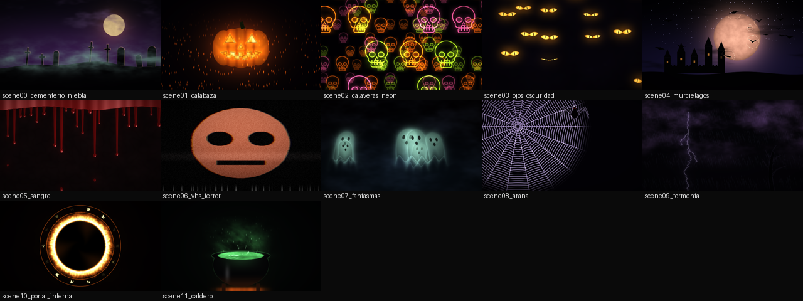

# Sets de visuales y el show de Halloween

Un **set** es un show: sus escenas, su cantidad y sus ajustes. El **núcleo** (`td/vjcore/`) es uno solo para todos los sets: MIDI, audio, dashboard, transiciones, Master FX, texto, grabación, láser y failsafe son los mismos. Cualquier arreglo del núcleo les llega a todos los shows a la vez.



*Las 12 primeras escenas de Halloween, renderizadas fuera de TouchDesigner con `td/tools/render_scenes.py` (escena sola, sin bloom ni Master FX).*

## Elegir el show

En el Text DAT donde pegaste `td/RUN_ME.py`:

```python
SET = 'halloween'      # o 'tdai2026' para el set de siempre
```

y **Run Script**. El reporte del build lo confirma en la primera línea:

```
VERIFICACION DEL BUILD   [...]
  set: HALLOWEEN 2026  (12 escenas, sets/halloween/visuals)
```

El build guarda el set en `td/config/active_set.txt`, así que al reabrir el `.toe` (o con **Reconstruir Todo**) sigue siendo el mismo. En `/project1` → System, **Set de visuales** lo muestra, pero no se cambia ahí: se cambia en `RUN_ME.py`.

Los Devices de audio y MIDI y el mapeo MIDI se conservan al cambiar de set. Los **presets por escena** y las **miniaturas** van por separado en cada set, porque la escena 3 de un set no tiene nada que ver con la 3 del otro.

## Dónde vive cada cosa

```
td/
├── visuals/                     ← set 'tdai2026' (98 escenas, sin cambios)
└── sets/
    └── halloween/
        ├── set.json             ← lo que cambia en este set
        └── visuals/             ← scene00_*.frag ... scene11_*.frag
```

`set.json` de Halloween:

| Clave | Valor | Qué hace |
|---|---|---|
| `modern_from` | `0` | Todas las escenas usan la lógica nueva: Detail con más recorrido al centro, audio cortado por la compuerta de música, gestos de piano |
| `audio_dance` | `false` | **Sin el twirl global** (`audioDanceUV`): el audio mueve elementos de cada escena, no la imagen entera |
| `media_scenes` | `[6]` | La escena 6 (VHS de terror) usa la carpeta Media |
| `fullres_scenes` | `[8, 9]` | Telaraña y tormenta, de líneas finas, siempre a resolución completa |

La cantidad de escenas sale de contar los `.frag` de la carpeta.

## Las 12 escenas

| # | Escena | Speed mueve | El audio hace | Detail |
|---|---|---|---|---|
| 00 | Cementerio en la niebla | nubes y niebla | bajo espesa y enciende la niebla; golpe = relámpago que recorta las lápidas | niebla, lápidas, luna, relámpago, verde tóxico, horizonte |
| 01 | Jack o'Lantern | llama y brasas | bajo sube la luz interior; golpe aviva la llama y suelta brasas; piano enciende los ojos | tamaño, llama, brasas, sonrisa, gajos, aura |
| 02 | Calaveras de neón | las tres capas | cada calavera mastica a su ritmo; golpe abre las mandíbulas; bajo enciende los ojos | tamaño, grosor, ojos, masticar, colores, halo |
| 03 | Ojos en la oscuridad | parpadeo y mirada | golpe abre más pares de ojos; bajo aviva el iris; las pupilas siguen la tecla del piano | cantidad, abiertos, tamaño, brillo, amarillo↔rojo, niebla |
| 04 | Murciélagos y castillo | bandada y aleteo | golpe dispersa a cada murciélago hacia su lado y hace parpadear ventanas; bajo = halo de la luna | cantidad, luna, aleteo, dispersión, luna sangre, ventanas |
| 05 | Sangre que chorrea | los hilos bajan | golpe estira de golpe la mitad de los hilos; bajo = brillo húmedo | hilos, largo, grosor, brillo, rojo↔negro, pared |
| 06 | VHS de terror (Media) | banda y ruido | golpe = salto de tracking; bajo separa el color | ruido, tracking, sepia↔rojo, barrido, banda, contraste |
| 07 | Fantasmas | flotan y ondulan | medios agitan el borde de cada uno; golpe hace que se asomen | cantidad, transparencia, borde, brillo, blanco↔verde, niebla |
| 08 | Araña en su tela | araña y brisa | golpe hace vibrar los hilos (cada anillo con su fase); agudos = destellos del rocío | radios, anillos, araña, vibración, rocío, plata↔violeta |
| 09 | Tormenta gótica | nubes y lluvia | golpe = rayo (en otro lugar cada vez) que enciende las nubes; agudos en la lluvia | lluvia, ramas del rayo, rayos sin golpe, brillo, violeta↔azul, árbol |
| 10 | Portal infernal | remolino y llamas | bajo levanta las llamas; golpe hace latir el anillo y enciende runas; medios mueven el remolino | tamaño, llamas, remolino, runas, naranja↔verde, humo |
| 11 | Caldero de bruja | vapor y burbujas | bajo enciende el líquido; golpe revienta burbujas grandes y aviva las brasas | burbujas, vapor, brillo, brasas, verde↔violeta, chispas |

Con **Speed en 0** todo queda quieto. Con Speed arriba de 0 y **en silencio**, el movimiento propio sigue y solo se apagan las reacciones al audio.

## Agregar escenas al set

Igual que siempre, con `--set`:

```bash
python3 td/tools/add_scene.py --set halloween --slug momia respuesta.frag
python3 td/tools/add_scene.py --set halloween --dir carpeta_de_frags/
```

## Verificar fuera de TouchDesigner

```bash
python3 td/tools/test_sets.py                                  # sets, Detail y compilación
TDAI_SET=halloween python3 td/tools/validate_shaders.py         # compila el set
python3 td/tools/render_scenes.py salida/ --set halloween       # PNG de cada escena + _hoja.png
python3 td/tools/render_scenes.py salida/ --set halloween --audio golpe --d 0.6
```

`render_scenes.py` dibuja el **mismo GLSL** que corre en TD (OpenGL 3.3 por software). Necesita `pip install moderngl numpy pillow` y Mesa (`libegl1 libgl1-mesa-dri` en Linux). Sirve para ver el aspecto; **no mide los FPS de tu máquina**.

## No verificado

Las escenas compilan y se ven bien en el render por software, pero **no se han probado en tu TouchDesigner**: falta ver los FPS reales y cómo se ven con bloom, Master FX y el proyector.
