# Sets de visuales y el show de Halloween

Un **set** es un show: sus escenas, su cantidad y sus ajustes. El **núcleo** (`td/vjcore/`) es uno solo para todos los sets: MIDI, audio, dashboard, transiciones, Master FX, texto, grabación, láser y failsafe son los mismos. Cualquier arreglo del núcleo les llega a todos los shows a la vez.

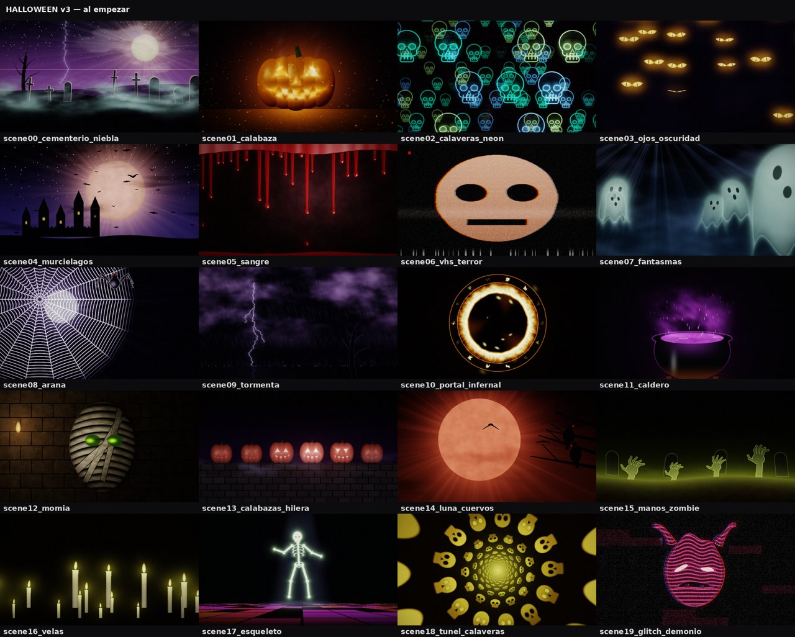

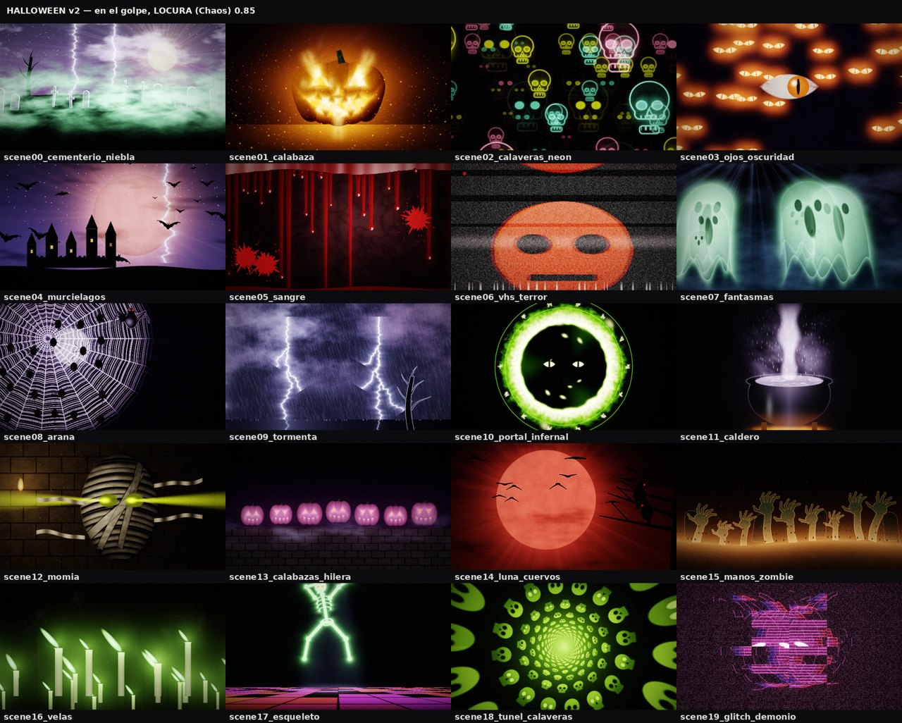

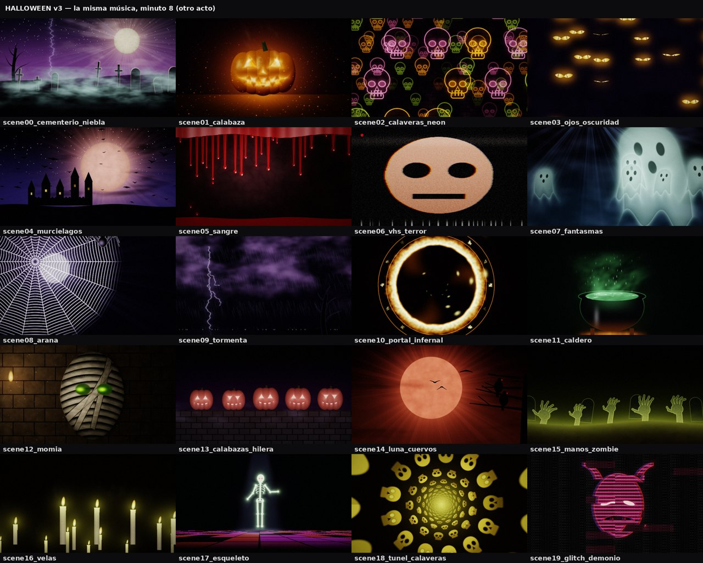

*Arriba: al empezar, con música y Chaos en 0.3. Al medio: en el golpe con la locura (Chaos) en 0.85. Abajo: la misma música en el minuto 8 (otro acto: otro encuadre, clima y color). Renderizadas fuera de TouchDesigner con `td/tools/render_scenes.py` (escena sola, sin bloom ni Master FX).*

## Elegir el show

En el Text DAT donde pegaste `td/RUN_ME.py`:

```python
SET = 'halloween'      # o 'tdai2026' para el set de siempre
```

y **Run Script**. El reporte del build lo confirma en la primera línea:

```
VERIFICACION DEL BUILD   [...]
  set: HALLOWEEN 2026  (31 escenas, sets/halloween/visuals)
```

El build guarda el set en `td/config/active_set.txt`, así que al reabrir el `.toe` (o con **Reconstruir Todo**) sigue siendo el mismo. En `/project1` → System, **Set de visuales** lo muestra, pero no se cambia ahí: se cambia en `RUN_ME.py`.

Los Devices de audio y MIDI y el mapeo MIDI se conservan al cambiar de set. Los **presets por escena** y las **miniaturas** van por separado en cada set, porque la escena 3 de un set no tiene nada que ver con la 3 del otro.

## Dónde vive cada cosa

```
td/
├── visuals/                     ← set 'tdai2026' (98 escenas, sin cambios)
└── sets/
    └── halloween/
        ├── set.json             ← lo que cambia en este set
        └── visuals/             ← scene00_*.frag ... scene19_*.frag
```

`set.json` de Halloween:

| Clave | Valor | Qué hace |
|---|---|---|
| `modern_from` | `0` | Todas las escenas usan la lógica nueva: Detail con más recorrido al centro, audio cortado por la compuerta de música, gestos de piano |
| `audio_dance` | `false` | **Sin el twirl global** (`audioDanceUV`): el audio mueve elementos de cada escena, no la imagen entera |
| `media_scenes` | `[6]` | La escena 6 (VHS de terror) usa la carpeta Media |
| `fullres_scenes` | `[8, 9]` | Telaraña y tormenta, de líneas finas, siempre a resolución completa |
| `output` | `[1280, 512]` | Salida **panorámica 2,5:1** para la tela de 5,0 × 2,0 m (ver abajo) |

La cantidad de escenas sale de contar los `.frag` de la carpeta.

## Las 31 escenas

Las 31 usan láminas horneadas (realismo sin costo en vivo); los scripts de horneado están en `td/tools/bake_plates_*.py`.

| # | Escena | Speed mueve | El audio hace | Detail |
|---|---|---|---|---|
| 00 | Cementerio en la niebla | nubes y niebla | bajo espesa y enciende la niebla; golpe = relámpago que recorta las lápidas | niebla, lápidas, luna, relámpago, verde tóxico, horizonte |
| 01 | Jack o'Lantern | llama y brasas | bajo sube la luz interior; golpe aviva la llama y suelta brasas; piano enciende los ojos | tamaño, llama, brasas, sonrisa, gajos, aura |
| 02 | Calaveras de neón | las tres capas | cada calavera mastica a su ritmo; golpe abre las mandíbulas; bajo enciende los ojos | tamaño, grosor, ojos, masticar, colores, halo |
| 03 | Ojos en la oscuridad | parpadeo y mirada | golpe abre más pares de ojos; bajo aviva el iris; las pupilas siguen la tecla del piano | cantidad, abiertos, tamaño, brillo, amarillo↔rojo, niebla |
| 04 | Murciélagos y castillo | bandada y aleteo | golpe dispersa a cada murciélago hacia su lado y hace parpadear ventanas; bajo = halo de la luna | cantidad, luna, aleteo, dispersión, luna sangre, ventanas |
| 05 | Sangre que chorrea | los hilos bajan | golpe estira de golpe la mitad de los hilos; bajo = brillo húmedo | hilos, largo, grosor, brillo, rojo↔negro, pared |
| 06 | VHS de terror (Media) | banda y ruido | golpe = salto de tracking; bajo separa el color | ruido, tracking, sepia↔rojo, barrido, banda, contraste |
| 07 | Fantasmas | flotan y ondulan | medios agitan el borde de cada uno; golpe hace que se asomen | cantidad, transparencia, borde, brillo, blanco↔verde, niebla |
| 08 | Araña en su tela | araña y brisa | golpe hace vibrar los hilos (cada anillo con su fase); agudos = destellos del rocío | radios, anillos, araña, vibración, rocío, plata↔violeta |
| 09 | Tormenta gótica | nubes y lluvia | golpe = rayo (en otro lugar cada vez) que enciende las nubes; agudos en la lluvia | lluvia, ramas del rayo, rayos sin golpe, brillo, violeta↔azul, árbol |
| 10 | Portal infernal | remolino y llamas | bajo levanta las llamas; golpe hace latir el anillo y enciende runas; medios mueven el remolino | tamaño, llamas, remolino, runas, naranja↔verde, humo |
| 11 | Caldero de bruja | vapor y burbujas | bajo enciende el líquido; golpe revienta burbujas grandes y aviva las brasas | burbujas, vapor, brillo, brasas, verde↔violeta, chispas |
| 12 | Momia | polvo y respiración de las vendas | bajo enciende los ojos; golpe afloja las vendas; el piano mueve la mirada | vendas, separación, ojos, aflojar, verde↔ámbar, polvo |
| 13 | Calabazas en hilera | llamas y niebla | cada calabaza sigue una banda (graves a la izquierda, agudos a la derecha); golpe = ola de luz | cantidad, latido, ola, tamaño, naranja↔violeta, niebla |
| 14 | Luna de sangre y cuervos | nubes, vuelo y ramas | bajo hace latir la luna; golpe espanta a los cuervos posados | cuervos volando, luna, ramas, posados, cobre↔sangre, nubes |
| 15 | Manos de zombie | suben y mueven los dedos | golpe = estirón (cada mano con su retraso) y saltan terrones; bajo = luz de la tierra | manos, cuánto salen, dedos, estirón, verde↔rojo, tierra |
| 16 | Velas | titilan | bajo agranda los halos; golpe estira las llamas; medios las inclinan | velas, llama, halo, salto, cálida↔verde, humo |
| 17 | Esqueleto bailando | paso de baile | golpe = salto y brazos arriba; bajo enciende las baldosas; medios mueven la cadera | tamaño, energía, grosor, salto, hueso↔neón, piso |
| 18 | Túnel de calaveras | avance por el túnel | bajo enciende el fondo; golpe = anillo de luz hacia la cámara; medios giran el túnel | calaveras por vuelta, avance, anillo, ojos, antorcha↔verde, niebla |
| 19 | Glitch demoníaco | respira y mueve el ruido | golpe lo rompe en bloques; bajo hace arder los ojos; agudos = estática | líneas, ruptura, separación de color, ojos, rojo↔violeta, estática |
| 20 | Galería embrujada (Media) | velas, polvo, balanceo | medios mecen los cuadros; golpe = tirón y la imagen "grita" | cuadros (3↔5), balanceo, grito, velas, sepia↔negativo, polvo |
| 21 | Espejo maldito (Media) | vapor, gotas, bombita | golpe raja el vidrio desde un punto; medios ondulan la imagen | vapor, rajaduras, pedazos corridos, fantasma, frío↔rojo, velas |
| 22 | La imagen se quema (Media) | avance del fuego y humo | bajo aviva la brasa; golpe = llamarada; con locura se prenden focos | velocidad, brasa, humo, cenizas, gris↔sepia, vela |
| 23 | Película de 1920 (Media) | grano, rayas, polvo | bajo = parpadeo; golpe salta el cuadro; medios lo mecen | rayas/polvo, parpadeo, saltos, iris, plata↔sepia, sala |
| 24 | La imagen sangra (Media) | llegan, sangran, caen | bajo acelera los hilos; golpe = salpicadura | pedazos, sangre, salpicaduras, desgarro, gris↔sepia, charco |
| 25 | Posesión (Media) | tiras, humo, llamas | golpe hace saltar las tiras y desdobla la imagen; bajo late las venas | tiras, salto, espejo, venas, gris↔rojo, sombras |
| 26 | La mansión embrujada | nubes, niebla, cortinas | bajo hace latir las ventanas; medios mecen las cortinas; agudos = chispas de las chimeneas; golpe = una silueta en una ventana | ventanas, niebla, luna, siluetas, cálido↔verde, hiedra |
| 28 | El bosque de los faroles | cámara entre los árboles, péndulos, niebla | bajo balancea los faroles (cada cuerda a su ritmo); medios = viento; agudos = luciérnagas; golpe = un farol se aviva y su cuerda baja | faroles, largo de cuerdas, niebla, hojas que caen, naranja↔violeta, ojos |
| 29 | La morgue | vapor y parpadeo | bajo hace zumbar y parpadear los tubos; medios = vapor frío de los cajones; agudos = gotas; golpe = una sábana respira | tubos que andan, vapor, sábanas, parpadeo con el golpe, blanco↔verde, sangre |
| 30 | El carnaval abandonado | la rueda y el carrusel giran | bajo = focos que laten en cadena; medios mecen la rueda; agudos = chispas del cable suelto; golpe = el carrusel da medio paso y un caballo salta | focos, velocidad de la rueda, niebla, caballos que saltan, feria↔rojo sangre, óxido |
| 27 | El reloj de la medianoche | engranajes, péndulo, polvo | bajo empuja el péndulo y los engranajes; medios = polvo en la luz; agudos = destellos del hierro; golpe = salta el segundero | engranajes, polvo, luz, salto, bronce↔verdín, grietas |

Con **Speed en 0** todo queda quieto. Con Speed arriba de 0 y **en silencio**, el movimiento propio sigue y solo se apagan las reacciones al audio.

## Visuales con imagen (20–25) y el orden del show

Seis escenas usan la **carpeta Media** (página Media → Carpeta de imágenes / GIFs), igual que el VHS (06). Todas muestran **la misma imagen a la vez**, cada una con su tratamiento, así que pasar de una a otra se siente como la misma foto que sigue sufriendo. Casi sin color: la imagen va en gris o sepia; el único color fuerte es el fuego o la sangre. Alrededor de cada imagen hay detalles de ambiente (cortinas, velas, azulejos, público, cruces, mesa con restos). Sin archivo cargado se ve una silueta difusa, nunca negro.

Formatos y modos de cambio de imagen: los de siempre (GIF, PNG, JPG, WEBP, MP4, MOV; MANUAL / TIEMPO / BEAT / COMPÁS / PIANO). Con el MiniLab: pad 6 = imagen siguiente, pad 8 = congelar, tira de modulación = recorrer la carpeta.

**Setlist del set.** `set.json` trae `"setlist"` y el rig arranca con **Bancos → Setlist** cargado y **Next/Prev siguen el setlist** prendido. Las escenas no se renumeran: Next/Prev (pads, teclado ← →, autopilot) siguen este orden, intercalando una de imagen cada 2–3 escenas, las suaves temprano y las más gore de madrugada:

`00 26 13 01 16 20 14 27 07 28 08 23 04 12 21 09 03 11 22 29 02 17 10 24 18 06 15 05 25 30 19`

La mansión (26) entra temprano porque se lee de lejos; el reloj (27) cae en el puesto 8 para estar al aire a la medianoche.

Para tocar en orden numérico, apaga **Next/Prev siguen el setlist**. El número de escena del teclado (1–9) y la grilla del dashboard siguen eligiendo por número.

Funciones del kit para imagen (en `common.glsl`, solo en escenas de Media): `hkMediaAspect`, `hkMediaCover`, `hkMediaHas`, `hkMediaGet(muv, lod, has)`; y para todas: `hkTone` (pocos colores), `hkCornerWeb`, `hkCandle`.

## Estilo aerógrafo retro (página Estilo)

`/project1` → **Estilo** tiene dos perillas que valen para todo el set:

- **Estilo** (0–1): lleva la imagen a un afiche pintado con aerógrafo. Las formas se ablandan (las láminas se leen desenfocadas, `set.json` → `"plate_lod": "uStyle * 3.2"`); la paleta se reduce a la paleta elegida (abajo); aparecen grano de spray, polvo y pelusas de papel. Con 0, todo queda como antes.
- **Estilomarco** (0–1): encierra la imagen en una ventana de arco sobre negro, con un halo violeta en el borde.
- **Estilopaleta** (0–1): elige la paleta del estilo, recorriendo 8 paletas de Halloween en este orden (con un fundido corto entre vecinas): **Calabaza** (violeta + naranja + crema), **Sangre** (ciruela, granate, rojo, hueso), **Veneno** (violeta + verde tóxico), **Fantasma** (azul noche, celeste, blanco), **Infierno** (rojo, naranja, ámbar), **Hechizo** (índigo, púrpura, magenta, lila), **Pantano** (petróleo, musgo, ocre), **Sepia**. Valores exactos: 0, 0.14, 0.29, 0.43, 0.57, 0.71, 0.86, 1.
- **Estiloauto**: la paleta cambia sola en cada acto de la escena (~78 s), con fundido.

Las paletas viven en `common.glsl` (`HK_PAL`, 6 tonos de oscuro a claro cada una) y sus nombres en `set.json` → `"style_palettes"`. Para agregar una: sumar 6 tonos, subir `HK_NPAL` y agregar el nombre.

El kit lo aplica en `hkFinish` a **todas** las escenas (`hkStyle`). Lo muy saturado (sangre, fuego, verde tóxico, ojos) conserva su tono propio con la luminancia de la paleta, así la sangre sigue roja con cualquier paleta. Adaptadas a fondo: **00 cementerio**, **01 calabaza**, **04 castillo**, **13 calabazas en hilera**, **14 luna y cuervos** y **16 velas** (siluetas contra resplandor, luna esfera con destellos, sin rayos duros, destellos en las llamas). Funciones del kit para adaptar otras: `hkStyleMoon`, `hkStyleRays`, `hkStyleBacklight`, `hkStyleSil`. Arranca en 0; un set puede traer otro valor inicial con `"style": [estilo, marco]`.

Costo en el banco: +3–5 ms con Estilo arriba. Para que el desenfoque de las láminas funcione en TD, las escenas con láminas o media usan filtro de entrada mipmap (lo pone el build).

## El MiniLab en Halloween

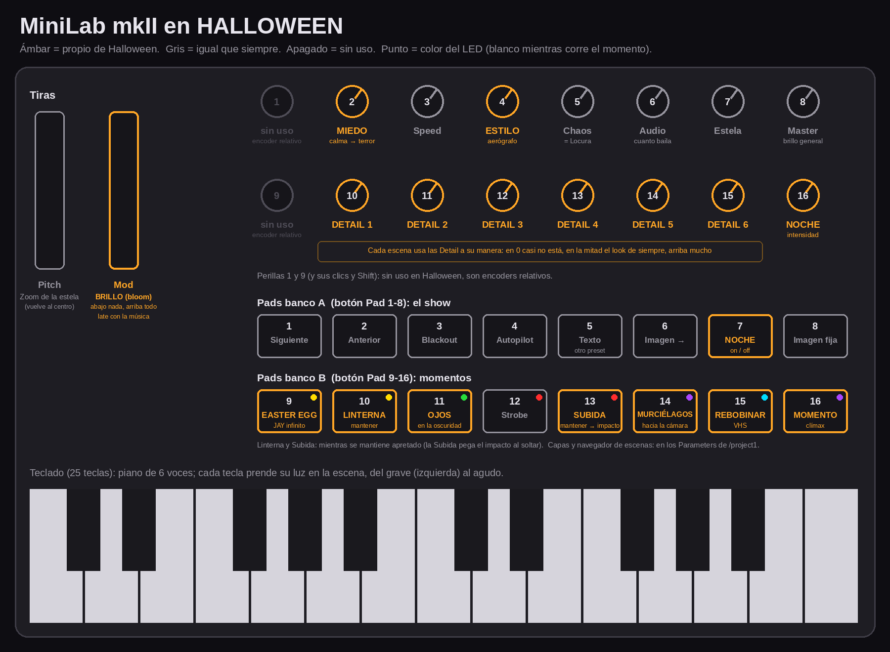

En Halloween varias perillas casi no aportaban (Density la usan 4 de 31 escenas; Hue, Look y Paleta quedan tapados por el estilo aerógrafo), y lo nuevo del set no tenía control físico. Con `set.json` → `"midi_redirect"` el **mismo control ya aprendido** hace otra cosa **solo en este set**. No se toca `midi_map.json` ni el set principal.

| Control | En Halloween | Antes / en el set principal |
|---|---|---|
| Perilla 2 | **Paleta del estilo** (Estilopaleta: Calabaza → … → Sepia) | Hue |
| Perilla 4 | **Estilo aerógrafo** (Estilo) | Density |
| Perilla 15 | **Noche, intensidad** (0 = sin efecto de noche) | Look |
| Perilla 16 | **Marco de arco** (Estilomarco) | Paleta |
| Pad 7 (banco A) | **Noche ON/OFF** (LED rojo = prendida) | Dos Capas |
| Pad 16 (banco B) | **Momento**: dispara ya el gran clímax de la escena (LED verde mientras dura) | Modo mezcla |
| Perilla 1 (girar) | **MIEDO**: de calma a terror en todas las escenas (fase 29) | Energía |
| Perilla 1 (clic) | **Momento**, igual que el pad 16 | Snapshot |
| Perilla 9 (girar) | **Navegador de escenas**: elegir la próxima sin tocar el aire | Detail 1 |
| Perilla 9 (clic) | **Lanzar** la escena elegida con su transición | Take (preview) |
| Pad 14 (banco B) | **Capa encima ON/OFF** (LED con el color de la capa) | Mirror |
| Pad 15 (banco B) | **Siguiente capa** (LED = la capa elegida) | Zoom |
| Tira de Mod | **Resplandor**: abajo nada brilla, al centro el bloom normal, arriba solo lo que brilla (fase 35) | Recorrer la carpeta de imágenes |

Todo lo demás queda igual: Speed, Chaos (locura), Audio, Estela, Master, Detail 2–6, Shift+1/Shift+9, los pads del show y el resto del banco B de efectos. Detail 1 queda en el preset de cada escena (se mueve desde el dashboard). Los **clics** de las perillas 1 y 9 hay que aprenderlos una vez (Learn Clic1 / Learn Clic9, apretando la perilla): cada uno manda su propio número de control según la memoria del MiniLab. La página MIDI Mapping muestra los nombres nuevos. Para volver a lo de siempre en Halloween, borrar `"midi_redirect"` del `set.json`.

Idea para más adelante (no hecha): el banco B podría pasar a efectos propios de Halloween.

## Locura (perilla Chaos) y kit compartido

En este set la perilla **Chaos (knob 4) es la locura**. En 0 las escenas son cinematográficas y sobrias; al subirla, cada golpe trae algo más fuerte: sacudida y zoom de impacto, relámpagos dobles, lenguas de fuego en la calabaza, un ojo gigante, murciélagos que se vienen encima, salpicaduras de sangre, VHS que rueda e invierte, fantasmas que se abalanzan gritando, un enjambre de arañitas, ojos dentro del portal, un géiser en el caldero, rayos de los ojos de la momia, calabazas que saltan, una bandada de cuervos, manos que revientan la tierra, ráfaga que tumba las velas, rayos X en el esqueleto, el túnel que se retuerce y el demonio que se desdobla.

Las funciones comunes viven en `td/sets/halloween/common.glsl` (en `set.json`, `"prelude": "common.glsl"`): acabado de cine (`hkFinish`: tonemap filmico, grano, negros con color, parpadeo de proyector), `hkShake`/`hkPunch`, rayos de luz `hkRays`, niebla `hkFog`, partículas `hkParticles`, rayos `hkBolt` y SDF básicos. Editar ese archivo cambia todas las escenas del set a la vez; **Recargar Shaders** lo toma.

## Rendimiento: nunca menos de 20 fps

Regla del show: **el FPS no puede bajar de 20**. Para eso:

- **Presupuesto por escena.** Medido con `render_scenes.py` (OpenGL por software, 640×360) en el **peor caso** (golpe, locura en 0.9, Detail en 0.5): las 20 escenas originales cuestan entre 6 y 12.4 ms (las 6 de imagen, 9–18 ms), promedio 9.5. Como referencia, en la misma prueba la mediana de las 98 escenas de `tdai2026` es 8 ms y el 10 % más pesado pasa de 23 ms. Ninguna escena de Halloween está en ese grupo pesado.
- **Lo que se hizo para lograrlo:** el ruido caro se calcula solo donde se ve (niebla solo cerca del suelo, humo solo en su columna, fuego solo en los cortes), los murciélagos van en grilla por capas (cada píxel mira 3, no 24), las manos y velas lejanas se saltan, y `hkFog` usa una deformación barata.
- **Failsafe con piso propio.** En `/project1` → Failsafe, **Actuar si el FPS baja de** = 24 por defecto. Si el FPS pasa 4 s debajo de eso, el rig baja la escala de render (lo que menos se nota) antes de llegar a 20. Antes usaba el aviso de 55 fps y degradaba de más.
- **Falta medirlo en tu máquina**: los ms de arriba sirven para comparar escenas entre sí, no son los de tu GPU.

## Historia: 20-25 minutos con una sola escena

Cada escena avanza sola por **actos de ~78 s** (16 actos ≈ 21 minutos antes de repetir) y tiene **eventos propios** que aparecen solos, aunque no haya golpe. Todo esto es aritmética sobre el reloj, **no cuesta fps**. Usa el reloj real de la música (`uRTime`): se queda quieto en silencio y sigue cuando vuelve el audio.

- **En todas, cada acto:** la cámara reencuadra despacio (acercamiento y paneo suaves) y cambia algo del clima o del color.
- **Eventos por escena:**

| # | Eventos que pasan solos |
|---|---|
| 00 | tormenta seca con relámpagos (~47 s), luna de sangre (~2 min); el acto cambia nubes y niebla |
| 01 | la vela se apaga y vuelve con llamarada (~71 s), la calabaza se ríe (~53 s) |
| 02 | ola de luz que cruza el muro (~41 s), apagón y reencendido (~89 s); paleta distinta por acto |
| 03 | todos parpadean a la vez (~37 s), el ojo gigante se abre solo (~103 s); cantidad de ojos por acto |
| 04 | bandada enorme (~61 s), relámpago (~53 s), luna que sangra (~2 min) |
| 05 | la pared sangra entera (~50 s), salpicadura sola (~79 s); densidad por acto |
| 06 | cambio de canal con estática (~44 s), la cinta se come y estira (~97 s) |
| 07 | un fantasma pasa volando pegado a la cámara (~59 s), desaparecen y vuelven (~83 s) |
| 08 | la araña baja hasta la cámara (~67 s), ráfagas que sacuden la tela (~43 s) |
| 09 | pico de tormenta con rayos seguidos (~57 s); intensidad por acto |
| 10 | el portal se abre de par en par con ojos adentro (~73 s); el remolino cambia de sentido por acto |
| 11 | erupción sola del caldero (~64 s); color de la poción por acto |
| 12 | la antorcha casi se apaga y solo quedan los ojos (~73 s), gira la cabeza al público (~41 s) |
| 13 | persecución de luz calabaza por calabaza (~47 s), todas se vuelven rojas (~83 s) |
| 14 | bandada grande que cruza la luna (~63 s), eclipse con anillo de fuego (~127 s), todos los cuervos giran la cabeza (~41 s) |
| 15 | horda de manos (~69 s), relámpago lejano que recorta el cementerio (~53 s); cantidad por acto |
| 16 | una corriente apaga las velas una por una y se reencienden (~61 s), luna que entra por el vitral (~83 s) |
| 17 | solo de baile enloquecido (~49 s), el piso hace olas (~91 s); estilo de baile por acto |
| 18 | acelerón por el túnel (~55 s), se encienden todos los ojos (~97 s); el túnel gira para otro lado por acto |
| 19 | el rostro se derrite (~43 s), posesión: ruptura total sin golpe (~89 s) |
| 20 | apagón: solo quedan las imágenes (~53 s), un cuadro se suelta (~67 s), todos negativos (~89 s) |
| 21 | el espejo se raja entero (~59 s), una mano limpia el vapor (~71 s), se corta la luz (~47 s) |
| 22 | cada vuelta el fuego empieza por otro borde; ráfaga que tira las cenizas (~61 s) |
| 23 | iris (~41 s), la cinta se quema (~73 s), cartel de título (~57 s), alguien del público se da vuelta (~67 s) |
| 24 | la pared llora sangre desde arriba (~50 s), se apaga la lámpara (~79 s) |
| 25 | se encienden los ojos (~43 s), posesión total (~89 s), las velas se avivan (~61 s) |

Los tiempos son aproximados: cada evento cae en un momento al azar dentro de su ventana, así no se siente mecánico.

Funciones del kit para esto: `hkAct()`, `hkActVal(seed)`, `hkEvent(seed, cada, dura)`, `hkEventPhase(...)`, `hkCam(p)`.

## Agregar escenas al set

Igual que siempre, con `--set`:

```bash
python3 td/tools/add_scene.py --set halloween --slug momia respuesta.frag
python3 td/tools/add_scene.py --set halloween --dir carpeta_de_frags/
```

## Imagen panorámica (tela 5,0 × 2,0 m)

En NILA la pared llega a unos 2,7 m y la gente tapa la parte de abajo. Para una imagen amplia hay que ganar **ancho**, no alto: tela de 5,0 × 2,0 m (2,5:1), de 0,7 m a 2,7 m del piso.

- El set sale a **1280 × 512** (`output` en `set.json`). Respeta el tope de 1280 px de la licencia Non-Commercial y tiene un 29 % menos de píxeles que 1280 × 720, así que los FPS no bajan.
- Las escenas no se estiran: `centered()` usa el formato real, así que se ve más escena a los lados con la misma altura.
- `show_frame` (Fit TOP) centra la salida en un cuadro 16:9 (`config.PROJECTOR_ASPECT`) con franjas negras arriba y abajo. La ventana al proyector muestra ese cuadro. Con salida 16:9 no cambia nada.
- Para volver a 16:9, borra `output` del `set.json` o cambia Output Width/Height en /project1 > Output.
- Proyector (estimado de la foto, medir): de 10.000 a 12.000 lm ANSI, láser, 1080p, throw ratio de unos 1,1–1,3 (distancia ÷ 5,0 m), lens shift vertical, colgado invertido en la estructura.
- Tela: 5,25 × 2,1 m de lycra de proyección gris clara mate en bastidor de aluminio, de una sola pieza y opaca, para tapar el letrero NILA.
- Vista previa: `python3 td/tools/render_scenes.py salida/ --set halloween --size 1280x512`.

Después de cambiar el formato hay que **Reconstruir Todo**.

## La noche: más oscuro y más gore con la hora

La fiesta va de las 22:00 a las 05:30 y el set acompaña. El canal `night` (0..1) sale del reloj de la máquina y lo usa el kit de Halloween en `hkFinish`, así que vale para todas las escenas sin tocarlas una por una.

- **Página Noche de /project1:**
  - **Efecto NOCHE prendido:** apaga o prende todo el efecto sin perder la hora ni la intensidad. En el MiniLab: **pad 7** (LED rojo = prendido). La **perilla 15** maneja la intensidad (0 = sin efecto).
  - **Noche automática:** usa el reloj.
  - **Hora de inicio / Hora de fin:** 22 y 5,5 por defecto; la ventana puede cruzar la medianoche.
  - **Noche manual:** se usa cuando Noche automática está apagada.
  - **Intensidad:** multiplica el efecto entero.
- **Antes y después de la ventana:** antes de la hora de inicio vale 0; después de la hora de fin (de día) vale 1.
- **Qué hace a medida que avanza:**
  - **Color:** quedan menos colores (solo rojos, naranjas y fuego), los negros se hacen más profundos, los brillos más fuertes y el viñeteo más cerrado.
  - **Desde 15 %:** humo en los bordes y brasas que suben por los costados.
  - **Desde 35–40 %:** telarañas en las esquinas de arriba y murciélagos que revolotean.
  - **Desde 55 %:** lenguas de fuego en el borde de abajo, que suben con el bajo y el golpe.
  - **Desde 70 %:** sangre que chorrea desde el borde de arriba.
  - **Desde 85 %:** latido rojo en los bordes con el bombo.
- **Rendimiento:** todo pasa en los bordes. El centro de cada escena no se tapa y ahí no se calcula nada.
- **Vista previa:** `python3 td/tools/render_scenes.py salida/ --set halloween --night 0.8`.

## Láminas: realismo sin cargar el procesador

Una escena puede traer **láminas**: capas PNG con lo que no se mueve (sierra, colinas, lápidas, suelo, luna, texturas de nubes y niebla), dibujadas con todo el detalle fuera de línea. En vivo el shader solo las lee y les pone encima todo lo que se mueve: niebla, luz, relámpagos, fuegos fatuos, viento y parallax. Leer una textura en el GPU cuesta casi nada.

- **Dónde van:** `td/sets/<set>/plates/sceneNN/*.png`. Entran al GLSL TOP después de ctrl (y de media), en orden alfabético. En el `.frag` se leen con `plate0(uv)`, `plate1(uv)`… y con `plateNWrap(uv)` para las texturas que se repiten.
- **Cuándo se cargan:** el build crea un Movie File In TOP por lámina. Si se agregan o quitan láminas, o se mueve la carpeta `td/`, hay que hacer **Reconstruir Todo**. Si solo cambia el contenido de un PNG, alcanza con recargar el archivo.
- **Tamaño:** máximo 1280 px por lado (licencia Non-Commercial). `test_sets.py` lo verifica.
- **Escena 00:** `python3 td/tools/bake_plates_cementerio.py` vuelve a generar sus 8 láminas (después, `build_atlas.py`):

| Lámina | Qué es |
|---|---|
| `1_lejos` | sierras y capilla: R luz, G cuál sierra, B ventanas, A cobertura |
| `2_medio_base` | colinas, reja, suelo y pasto (sin lápidas) |
| `3_medio_lapidas` | lápidas del cementerio en 3D: color sin luz |
| `4_cerca` | lápidas cercanas y cruz celta en 3D (color sin luz), suelo y pasto |
| `5_ruido` | ruido que se repite: R nubes, G y B niebla, A detalle |
| `6_luna` | luna con cráteres (256 px) |
| `7_lapidas_normal` | relieve 3D de las lápidas del medio (RG) y, en B, en qué punto de D2 aparece cada una |
| `8_cerca_normal` | relieve 3D de las cercanas (RG) y su oclusión (B) |

- **Codificación del color:** las láminas de color guardan color lineal ×2 con gamma 2.2; la escena lo decodifica con `plateCol()`.
- **Reemplazarlas por fotos o arte:** sirve cualquier PNG con el mismo nombre y el mismo encuadre (ver las constantes `FAR_Y`, `MID_Y` y `NEAR_Y` en la escena).

## Guion de la noche (sin MIDI)

`guion.json` de este set lleva la noche entera sin controlador: todas las escenas en el orden del setlist, de 22:00 a 05:30 (~15 min cada una; el reloj, a la medianoche), con subidas, picos y golpes de efecto. Con **Guion → Seguir la hora real** se posiciona solo según el reloj. Ver [54_GUION](54_GUION.md).

## Presets de la noche (punto de partida por escena)

El set trae `td/sets/halloween/presets_default.json`: un preset por escena (Speed, Chaos, Detail 1–6) con valores que ya se ven bien con música y el color "de siempre" de cada escena. Con **Presets → Recall al cambiar escena** prendido (viene prendido), al entrar a una escena las perillas saltan a su punto de partida; de ahí ajustás en vivo.

- **Snapshot escena activa** guarda lo que tenés ahora para esa escena (en `td/config/presets_halloween.json`, que no se versiona). Lo guardado gana sobre el de fábrica, escena por escena.
- **Volver a los presets de fábrica del set** borra los Snapshot y vuelve a los de fábrica.
- Las perillas del MiniLab son absolutas: después de un recall, la primera vez que movés una perilla el valor salta a donde está la perilla física.

## Miniaturas del dashboard

El set trae sus miniaturas ya hechas en `td/sets/halloween/thumbs/` (una por escena, recorte central 16:9), generadas fuera de TD con:

```bash
python3 td/tools/render_thumbs.py --set halloween --media una_imagen.png
```

`--media` es la imagen que se ve en las escenas de imagen (06, 20–25); sin eso usan una cara de prueba. Dentro de TD, el pulso **Bakethumbs** (página System) las vuelve a sacar del render real y las pisa: conviene hacerlo una vez con tu carpeta de imágenes cargada, así las miniaturas de 20–25 muestran tus imágenes.

## Verificar fuera de TouchDesigner

```bash
python3 td/tools/test_sets.py                                  # sets, Detail y compilación
TDAI_SET=halloween python3 td/tools/validate_shaders.py         # compila el set
python3 td/tools/render_scenes.py salida/ --set halloween       # PNG de cada escena + _hoja.png
python3 td/tools/render_scenes.py salida/ --set halloween --audio golpe --d 0.6
```

`render_scenes.py` acepta `--chaos 0.9` para ver la locura. Dibuja el **mismo GLSL** que corre en TD (OpenGL 3.3 por software). Necesita `pip install moderngl numpy pillow` y Mesa (`libegl1 libgl1-mesa-dri` en Linux). Sirve para ver el aspecto; **no mide los FPS de tu máquina**.

## No verificado

Las escenas compilan y se ven bien en el render por software, pero **no se han probado en tu TouchDesigner**: falta ver los FPS reales y cómo se ven con bloom, Master FX y el proyector.

## Entrada de audio floja (Mac)

Si el dashboard muestra `AUDIO OK(1)`, la entrada es mono. Casi siempre es el micrófono de la MacBook: llega con poco volumen y casi sin graves, roza el piso de silencio (`SILENCE_RMS_THRESHOLD`, ahora 0.002) y en las partes suaves se corta todo el baile. En ese caso:

- Mejor: entrar por línea desde la mezcladora (interfaz de audio), o por BlackHole si la música sale de la misma Mac. Elegirla en `audio1`.
- Rápido: subir `/project1` → página Audio → **Ganancia de entrada** (`Inputgain`). Queda guardada en `td/config/devices.json` y sobrevive a Reconstruir Todo. Si la entrada está baja, el dashboard muestra `>> ENTRADA BAJA`.

## Atlas de láminas (Mac / Metal)

En la MacBook, un GLSL TOP con **más de 3 texturas de entrada no compila** ("The GLSL Shader has compile errors"): las escenas 00–19 salían en damero. Por eso las láminas de cada escena van juntas en 1–2 atlas (`plates/sceneNN/atlas0.png`, `atlas1.png` y `atlas.json`), cada uno de 1280 px como máximo (tope de la licencia). Así cada escena usa como mucho 3 entradas: control + 2 atlas, o control + media + 1 atlas.

- `td/tools/build_atlas.py` arma los atlas. **Hay que volver a correrlo cada vez que se rehornea una lámina.** Si el atlas no coincide con las láminas, se ignora y se vuelve a las texturas sueltas.
- Si una escena no entra, se achican primero sus láminas más grandes. El `lodbias` de cada lámina corrige el nivel de mip.
- Los `.frag` no cambian: `plateN`, `plateNWrap` y `plateNWrapLod` mantienen el mismo contrato.
- Pruebas: `td/tools/test_atlas.py` (≤ 3 entradas por escena y atlas al día) y `test_sets.py` (atlas ≤ 1280 px).
- En TD, `op('/project1/control_script').module.revisarShaders()` lista las escenas que no compilan, con el texto del Info DAT.

## Fase 11: piano propio, perillas sin saltos y clímax en tres tiempos (escenas 00–06)

**Base, para todas las escenas:**
- **Piano polifónico:** 6 voces (canales `kclock`, `k0pos`…`k5off`). En GLSL están `keyPos(i)`, `keyVel(i)`, `keyAge(i)`, `keyRelAge(i)`, `keyHeld(i)` y `keyEnv(i, ataque, caída)`. Mientras la tecla sigue apretada, la envolvente se sostiene. Las voces las asigna `midi_logic._voiceOn/_voiceOff` (nota apretada y nota soltada). El piano usa su propio reloj, así que responde aun en silencio.
- **Gesto genérico del piano apagado en Halloween:** `set.json` → `"piano_gesture": false`. Cada escena reacciona por su cuenta.
- **Detail sin saltos:**
  - Las seis perillas pasan por un Lag de 0.25 s (`detail_lag` en control.py).
  - Las cantidades usan `revealAt(n, i)`: cada elemento nuevo aparece de a poco, en vez de `floor()`.
- **Clímax en tres tiempos:**
  - `hkClimax(seed, cada, largo)` devuelve (aviso, pico, secuelas, fase).
  - `hkGrandClimax(seed)` es un clímax grande cada ~4.5 min que reemplaza al común (`hkClimaxOr`).
  - `hkOffWindow(fase, o, r)` apaga un elemento en el aviso y lo devuelve en las secuelas.
- **Setlist:** reordenado de tranquilo a intenso y luego a cierre oscuro: 0, 13, 1, 16, 20, 14, 7, 8, 23, 4, 12, 21, 9, 3, 11, 22, 2, 17, 10, 24, 18, 6, 15, 5, 25, 19.

**Por escena:**

| Escena | Piano | Clímax |
|---|---|---|
| 00 | Un alma por tecla que sube de la tumba. D2 suma lápidas de a una, que suben de la tierra (láminas `2_medio_base`, `3_medio_lapidas`, `7_lapidas_normal`) | Nubes tapan la luna → luna roja, temblor y almas → niebla rojiza |
| 01 | Llamas flotantes que iluminan pared y mesa; una tecla fuerte hace reír | Viento → apagón con ojos rojos → llamarada |
| 02 | Calaveritas de neón en la pared que también la iluminan | Los carteles fallan de a uno → apagón con relámpagos → vuelven en cadena |
| 03 | Pares de ojos nuevos; D1 los abre de a uno | Se cierran todos → ojo gigante que mira y fija la mirada → vuelven |
| 04 | Bandaditas que giran mientras la tecla está apretada y al soltar vuelan a la cámara; D1 sin saltos | Remolino frente a la luna → luna de sangre → estallan hacia la cámara |
| 05 | Chorros que manan mientras la tecla sigue apretada; D1 con columnas fijas | Más hilos → cortina de sangre en toda la pared → corte de luz |
| 06 | Línea de tracking a la altura de la nota | La figura se levanta y camina a la cámara → la cinta se come |

- Herramienta de prueba: `render_scenes.py --keys pos:vel:edad[:1]` y `--chan canal=valor`.

## Fase 12: escenas 07–13

Mismo tratamiento que la fase 11: piano propio, Detail sin saltos y clímax en tres tiempos.

| Escena | Piano | Detail sin saltos | Clímax |
|---|---|---|---|
| 07 | Fantasma que cruza; apretada se acerca, al soltar se va al fondo | D1 suma fantasmas de a uno | Espiral frente a la puerta → entran todos con estallido de luz → vuelven de a uno |
| 08 | Arañitas colgadas de su hilo | D1 y D2: radios y anillos fijos, cada uno aparece por su cuenta | La tela vibra y bajan arañitas → la araña grande baja hasta la cámara → sube |
| 09 | Rayo por tecla; apretada chisporrotea; con tope de brillo | Ramas del rayo continuas; la ventana de la granja se prende y apaga con fundido | La tormenta crece y los rayos se acercan → rayo al árbol → el árbol arde y la granja se apaga |
| 10 | Chorro de fuego desde el anillo; al soltar sale como bola | Color del fuego en fundido (antes saltaba en D5 = 0.5); runas con fundido | Runas de a una → se abre y salen brazos con garras → onda de fuego |
| 11 | Burbuja que crece apretada y al soltar revienta en chorro | D1 suma burbujas de a una; color por acto en fundido | Hervor → la cara grita en el vapor → erupción con lluvia verde → piso brillando |
| 12 | Vendas que flamean a la altura de la nota; la momia mira la tecla | D1 continuo (las vendas se aprietan) | Las antorchas se apagan → jeroglíficos, giro de cabeza y rayos de los ojos → llamarada |
| 13 | Prende con todo la calabaza de esa posición, con lengua de fuego | D1 continuo: la fila se acomoda y la nueva crece; ventanas con fundido | Persecución cada vez más rápida → todas al rojo escupiendo fuego → el cuervo vuela |

## Fase 13: escenas 14–19

| Escena | Piano | Detail sin saltos | Clímax |
|---|---|---|---|
| 14 | Un cuervo levanta vuelo de la rama | D1: voladores de a uno, separados de la bandada; D4: 8 lugares fijos y el nuevo llega volando | Giran la cabeza y empieza el eclipse → la bandada cruza la luna → ramas vacías y vuelven de a uno |
| 15 | La mano de la tumba más cercana sale, se estira y araña | D1: cada mano sale de la tierra | Temblor y rayo, sale una mano → ola de manos de izquierda a derecha → arañan el aire |
| 16 | Aviva o enciende la vela de esa posición | D1: la vela nueva se enciende de a poco | Corriente que las inclina → se apagan de izquierda a derecha → se encienden desde el centro |
| 17 | Un paso por zona del teclado: patada izquierda, brazos arriba, cabeceo, patada derecha | — | Olas de luz en el piso → dos esqueletos más bailan el solo → se van |
| 18 | Anillo de ojos rojos a la profundidad de la nota | Ojos de D4 con fundido; se quitó el acelerón que saltaba hacia atrás al terminar | Acelerón → ola de ojos hacia la cámara → frenada con sacudida y polvo |
| 19 | Ojos que arden y franja de glitch a la altura de la nota | — | Interferencia y se derrite → posesión en bloques con copias → vuelve con los ojos ardiendo |

- **Optimización del piano:** `keyEnv` y las demás funciones leen cada dato de la voz por separado y cortan apenas la voz no suena. Sin teclas, un bucle de 6 voces cuesta 6 lecturas, no 24. En el render por software, la 18 bajó de 0.30 s a 0.18 s y la 19 de 0.24 s a 0.17 s.

## Fase 14: escenas de imagen 20–25

| Escena | Piano | Detail sin saltos | Clímax |
|---|---|---|---|
| 20 Galería | El cuadro de esa posición grita (negativo un instante) y su lámpara se aviva | D1 continuo: los cuadros se reacomodan y el nuevo crece | Apagón y se tuercen de a uno → todos en negativo → vuelven parpadeando |
| 21 Espejo | Estrella de grietas que crece mientras la tecla sigue apretada | — | Vapor total → una mano limpia → se raja entero |
| 22 Se quema | Llamarada y chispas a la altura de la nota | D1 ya no cambia la duración de la vuelta (antes saltaba el frente o la foto): ciclo fijo de 22 s y D1 = velocidad del frente | Calor → incendio con llamaradas enormes → ráfaga que se lleva las cenizas. Para que no se "des-queme" al terminar, el clímax no adelanta la quemadura |
| 23 Película | Rayón blanco en la posición de la nota y salto de cuadro | — | Saltos e iris que se cierra → la cinta se quema hasta el blanco → cartel y alguien del público se da vuelta |
| 24 Sangra | Chorro de sangre que brota de la imagen | D1 = cortes en una grilla fija; los pedazos sin cortar quedan pegados como una hoja | La lámpara titila → la imagen llora a chorros → se apaga y la sangre brilla sola |
| 25 Posesión | Tirón de la tira a la altura de la nota y ojos rojos | D1 continuo | Velas y ojos → venas hasta el centro y posesión total → todo queda rojo |

- **Miniaturas:** `render_thumbs.py` define `HK_STILL` y `hkClimax` devuelve 0, así cada miniatura muestra la escena en reposo y no un clímax a medias.


## Fase 15: pad Momento y transiciones de Halloween

**Momento (pad 16).** Dispara al instante el **gran clímax** de la escena que está al aire (aviso, pico y secuelas, 22 s), sin esperar el calendario automático. Mientras dura, el LED queda verde y otra pulsada no hace nada (no lo reinicia a la mitad). Durante el momento el calendario automático se calla. Funciona igual en todas las escenas, porque todas usan `hkClimax`/`hkGrandClimax`.

- Python: `control_script.triggerMoment()` guarda el `kclock` en `Momenton` (canal `moment`). `MOMENT_SECONDS` = 22.
- GLSL (`common.glsl`): si `uKclock - uMoment` está entre 0 y `HK_MOMENT_LEN`, `hkClimax` y `hkGrandClimax` devuelven ese clímax. Las dos constantes tienen que coincidir (lo verifica el test).
- Corre con el reloj del piano: funciona aunque no haya música.

**Transiciones.** Página *Transitions* → **Estilo de transición**:

| Estilo | Qué se ve | Duración mínima |
|---|---|---|
| Fundido | El crossfade de siempre | — |
| Niebla | Sube un banco de niebla, la escena nueva aparece por donde la niebla es menos densa | 1,8 s |
| Sangre | Chorrea desde arriba hasta tapar todo y se escurre hacia abajo mostrando la nueva | 2,0 s |
| Rayo | La escena se apaga en tormenta, cae un rayo y en el fogonazo ya está la nueva | 1,0 s |
| Apagón (velas) | La luz falla y se corta, quedan cinco velas, vuelve titilando con la nueva | 2,2 s |
| **Halloween (al azar)** | Uno de los cuatro en cada cambio, sin repetir el anterior. **Es el de este set** (`set.json` → `"transition_style"`) | — |

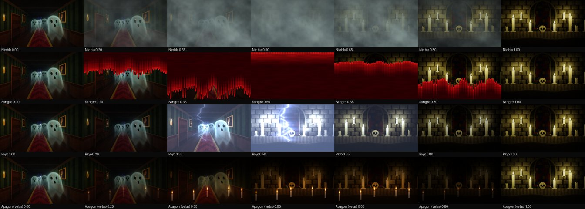

- El fundido dura `max(Transition Seconds, mínimo del estilo)`: con Energía alta (fundidos de 0,3 s) igual se llega a leer el efecto. Para cortes rápidos, elegir **Fundido**.
- `program_trans` (GLSL con 3 inputs: A, B y control) solo cocina **durante** un cambio con estilo. El switch `trans_pick` elige entre él y el crossfade. Fuera de los cambios cuesta 0 FPS. En los extremos devuelve exactamente la escena de cada lado, así que el switch no salta al soltar.
- Otro Next a mitad de un cambio mantiene el efecto que está corriendo.
- Hoja fuera de TD: `python3 td/tools/render_transitions.py salida.png --set halloween --ab 7,16`. Test: `td/tools/test_transiciones.py`.
- Cambian CHOPs (`xfade_sel`, `xfade_ctrl_lag`), canales (`moment`, `xfade`, `transfx`) y parámetros: hace falta **Reconstruir Todo**.

## Fase 16: escenas nuevas 26 (mansión) y 27 (reloj)

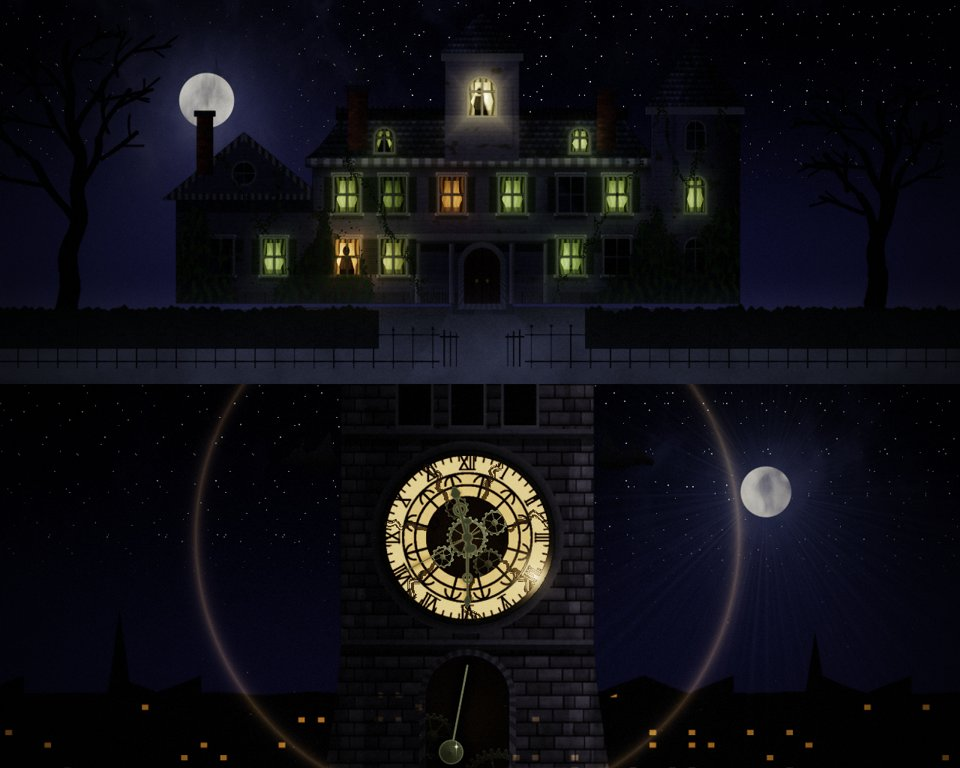

Las dos con láminas horneadas, piano propio, Detail sin saltos y clímax en tres tiempos. Cuestan menos que la 00 en el banco de prueba. El reloj quedó como **27** (no 28) porque las escenas se numeran sin huecos; si después se suman el bosque de faroles, la morgue y el carnaval, irán 28, 29 y 30.

| Escena | Piano | Clímax | Gran clímax |
|---|---|---|---|
| 26 La mansión embrujada | La nota elige la ventana (grave = izquierda), la enciende y aparece una silueta; la fuerza la hace más nítida; mantenida, se queda mirando; un acorde llena varias ventanas | Las ventanas se apagan de a una → una vela baja de la torre de ventana en ventana → la puerta se abre con un golpe de luz → las ventanas vuelven | Además, cielo de tormenta con relámpagos y murciélagos que salen de la torre |
| 27 El reloj de la medianoche | Cada tecla es una campana: se enciende el número de esa posición (I…XII) y sale un anillo de luz que deja caer polvo; las graves, más grandes; mantenida, vuelve a sonar | Las agujas se disparan hasta las doce y la esfera se pone roja → doce campanadas, cada una con anillo y temblor → salen murciélagos del campanario y las agujas vuelven a la hora | Además, relámpagos y la esfera se raja entera mientras dura |

- **El reloj marca la hora de la fiesta:** sale de la Noche (`uNight`, 22:00 → 05:30). Si está al aire a la medianoche real, llega su gran clímax solo. El guion lo pone al aire de 23:52 a 00:08. Con **Noche manual**, mover la perilla por las 00:00 también lo dispara.
- **Mansión:** 19 ventanas. Su geometría está en un bloque del `.frag` que el horneado lee tal cual (`// >>> MANSION_GEOM`), así la lámina y el shader no se desfasan. El reloj hace lo mismo con `// >>> RELOJ_GEOM`.
- **Láminas:** `bake_plates_mansion.py` y `bake_plates_reloj.py`, después `build_atlas.py`. Las marcas guardan todo en RGB con A = 1: con A = 0, PIL premultiplica al achicar y se pierde el dato.
- **Orden del show y guion:** las dos entran al setlist (arriba) y `guion.json` se rehízo para 28 escenas: cada una conserva sus Detail y su golpe de efecto, y la locura y la velocidad suben con la hora.
- **Reconstruir Todo:** hay escenas y láminas nuevas.

## Fase 17: escena 28 (el bosque de los faroles)

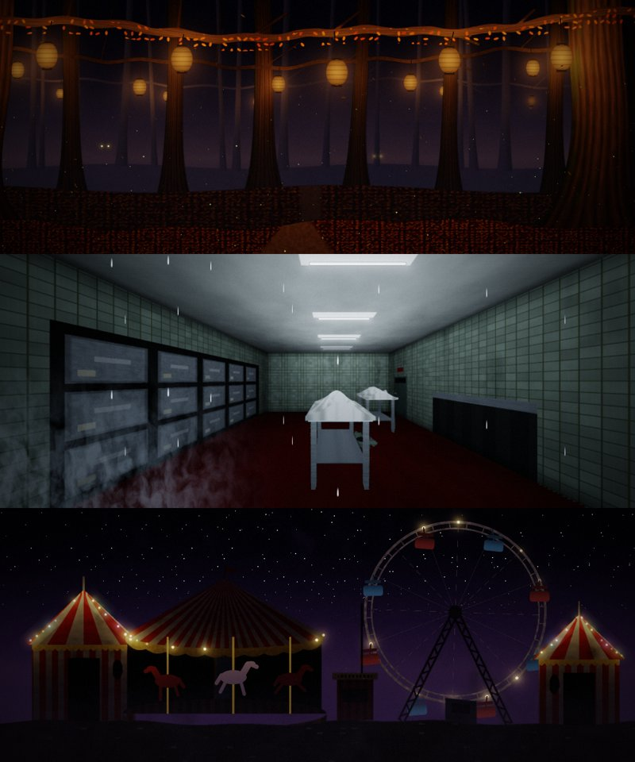

Tres capas de bosque de otoño con paralaje (la cámara se mueve entre los árboles con Speed, aun en silencio) y 16 faroles de papel que cuelgan de las ramas de cada capa e iluminan sus troncos. Las ramas y el suelo comparten geometría con el horneado (`// >>> FAROLES_GEOM`, `bake_plates_faroles.py`).

- **Piano:** la tecla prende el farol de esa posición (grave = izquierda) y lo aviva; un acorde prende varios; mantenida, sigue avivado.
- **Clímax (~93 s, 20 s):** los faroles se apagan de a uno y se encienden ojos entre los troncos → vuelven a prenderse desde el fondo hacia adelante, como un camino que llega a la cámara → los ojos se cierran. **Gran clímax:** faroles rojos, más ojos y una ráfaga de hojas.
- **Eventos:** una ráfaga cada ~59 s; algo mira desde el fondo cada ~79 s.
- Entra en el setlist después de los fantasmas (07); el guion se rehízo para 29 escenas y el reloj sigue al aire a la medianoche (23:48–00:04).
- **Reconstruir Todo:** escena y láminas nuevas.

## Fase 18: escena 29 (la morgue)

Sala de autopsias hecha por trazado de rayos en el horneado (`bake_plates_morgue.py`, geometría compartida `// >>> MORGUE_GEOM`): la lámina guarda la profundidad de cada píxel, así la luz de cada uno de los cuatro tubos fluorescentes se calcula en vivo sobre el punto real de la sala (azulejos, cajones, mesas, sábanas, piso mojado con brillo).

- **Piano:** se abre el cajón de esa posición (grave = el más cercano), sale vapor y asoma una mano; mantenida, la mano se queda afuera.
- **Clímax (~97 s, 20 s):** los tubos se apagan hacia el fondo y queda la luz roja de emergencia → bajo la sábana de la mesa de adelante una figura se sienta → la luz vuelve parpadeando y la mesa está vacía. **Gran clímax:** además se abren todos los cajones.
- **Eventos:** un tubo se muere un rato cada ~57 s; una camilla tiembla cada ~77 s.
- Va de madrugada (después de *Se quema*). El guion ahora reparte los turnos para que el del reloj quede **centrado en la medianoche** (23:53–00:08) aunque cambie la cantidad de escenas.
- **Reconstruir Todo:** escena y láminas nuevas.

## Fase 19: escena 30 (el carnaval abandonado)

Feria vieja de noche (`bake_plates_carnaval.py`, geometría compartida `// >>> CARNAVAL_GEOM`). Lo fijo va horneado (carpas, carrusel, boletería, patas de la rueda, reja); en vivo giran la rueda con sus góndolas que se mecen y los caballos del carrusel, y laten las guirnaldas de focos.

- **Piano:** la tecla enciende los focos de esa sección de la feria (grave = izquierda); mantenida, la luz corre por las guirnaldas hacia los costados.
- **Clímax (~99 s, 20 s):** la rueda acelera hasta chirriar y tiembla todo, los focos se vuelven rojos y en la góndola más alta aparece la silueta de un payaso → apagón total salvo su sonrisa → la feria vuelve. **Gran clímax:** lluvia de chispas y el carrusel desbocado.
- **Eventos:** se corta una guirnalda cada ~63 s; una góndola se queda balanceando cada ~81 s.
- Va al final de la noche, antes del glitch demoníaco (19).
- **Reconstruir Todo:** escena y láminas nuevas.

## Fase 20: cementerio en 3D (prueba de realismo)

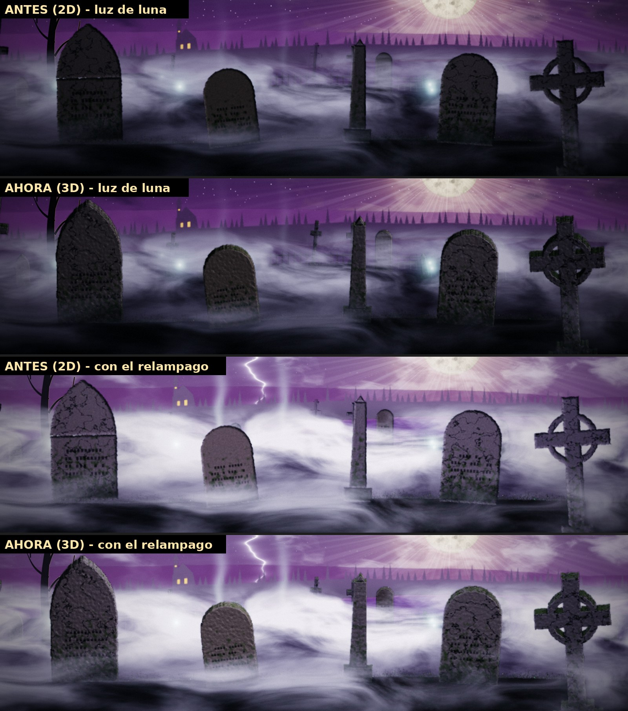

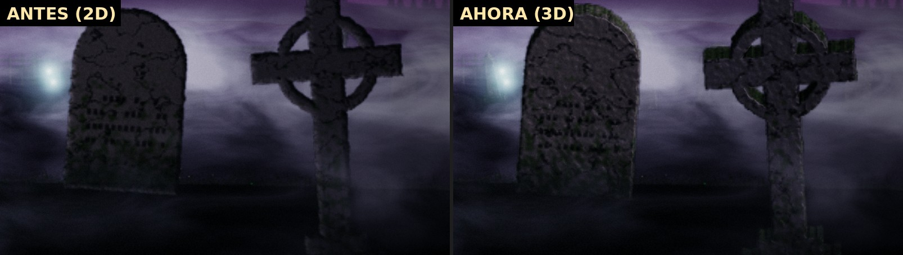

Las lápidas de la escena 00 dejaron de ser siluetas con luz pintada: se hornean como **sólidos 3D** por trazado de rayos (`bake_plates_cementerio.py`, sección 3D). Tienen espesor, cantos redondeados y gastados, la cara de arriba a la vista (la cámara mira un poco hacia abajo) y musgo donde junta agua. El horneado saca el color **sin luz** y el **relieve** (normal) de cada píxel; la luz se calcula en vivo (`stoneLight` en la escena):

- la luna desde arriba a la derecha, con el lado en sombra más oscuro;
- un contraluz que enciende los cantos y las caras de arriba;
- un brillo húmedo suave;
- el **relámpago desde el lado donde cae el rayo**, que cambia en cada golpe.

**Costo:** +5 % frente a la versión 2D en el banco de prueba (0,206 contra 0,195 s); el relieve entra en los mismos dos atlas, sin achicar nada (la luna pasó a 256 px). Hay que confirmar los FPS en TD. Si convence, el mismo camino sirve para las demás escenas con objetos sólidos (calabaza, mansión, troncos del bosque, torre del reloj).

**Reconstruir Todo:** cambiaron las láminas de la escena 00.

## Fase 21: calabazas en 3D (escenas 01 y 13)

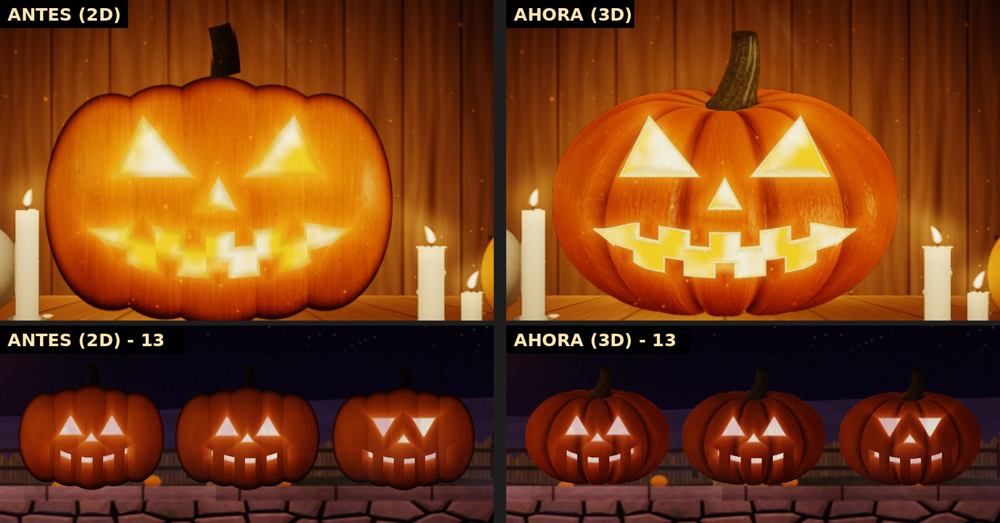

La calabaza principal (que la 13 reusa en la hilera) ahora es un **sólido 3D** hecho por trazado de rayos en `bake_plates_calabaza.py`: cuerpo achatado con 10 gajos y surcos hondos que se cierran en los polos, hundido donde nace el tallo, tallo retorcido con estrías y la cara de arriba a la vista. La lámina `5_calabaza_relieve` guarda su normal real y la oclusión de los surcos; la luz de la vela, la luna y las velas de la mesa se calcula en vivo como antes, pero ahora marca cada gajo.

- **El tallado tiene grosor (01):** en el borde de cada corte se ve la pared de pulpa iluminada por la vela, más ancha del lado hacia donde se curva la calabaza, con un canto oscuro del lado de la cáscara.
- **Costo en el banco de prueba:** 01 igual que antes (~0,20 s); 13 sube ~20 % (0,20 → 0,245 s) porque la calabaza nueva tapa más superficie. Hay que confirmar los FPS en TD.
- Después de hornear la 01 hay que correr `bake_plates_hilera.py` (copia la calabaza a la 13) y `build_atlas.py`.
- **Reconstruir Todo:** cambiaron las láminas de 01 y 13.

## Fase 22: mansión con relieve (escena 26)

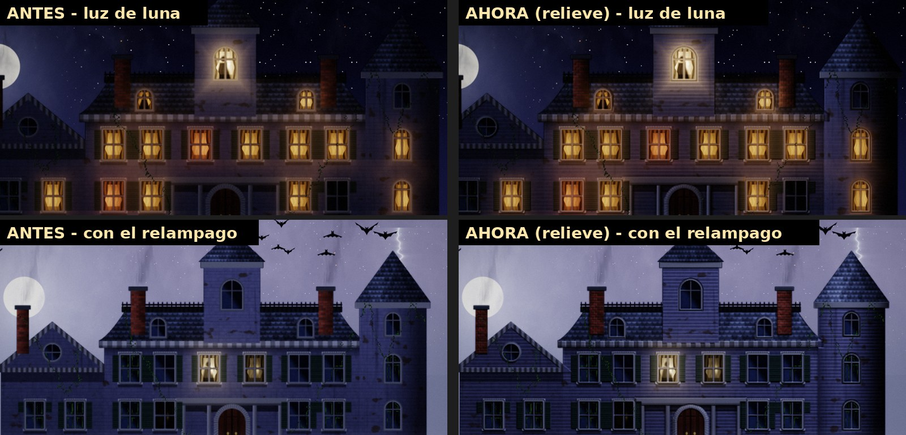

La fachada tiene ahora un **mapa de alturas** horneado (`height()` en `bake_plates_mansion.py`, lámina `4_relieve`: normal en RG, cavidad en B): tablas que sobresalen, cornisa y molduras, ventanas y puerta hundidas, persianas con tablillas, mansarda inclinada, torreón cilíndrico, conos, aguja, chimeneas de ladrillo y columnas. En vivo:

- la luna ilumina desde arriba a la izquierda, con contraluz en los cantos; el torreón queda en sombra del lado opuesto;
- el **relámpago** llega desde el lado donde cae el rayo (en el gran clímax se ve muy bien);
- la luz de cada ventana pega más en lo que la mira: el canto de las persianas, el alféizar, el marco.

**Costo:** ~20 % más que antes en el banco de prueba, al nivel de la escena más pesada del set (el bosque de faroles). Confirmar los FPS en TD. **Reconstruir Todo:** lámina nueva.

## Fase 23: reloj con relieve (escena 27)

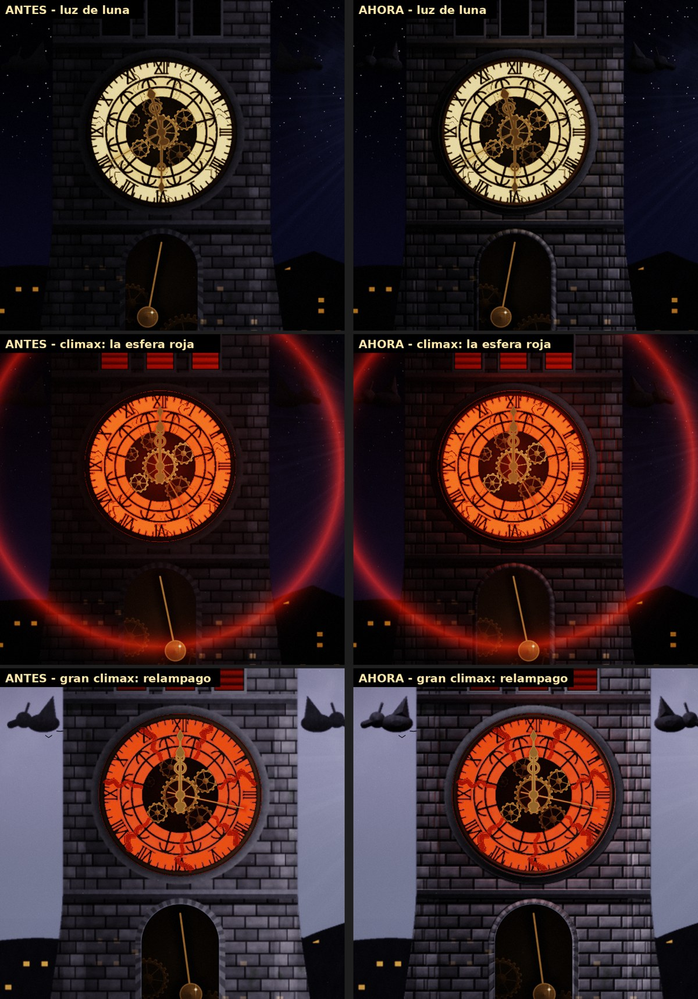

Mapa de alturas horneado (`height()` en `bake_plates_reloj.py`, lámina `4_relieve`): sillares con juntas hundidas, pilastras, cornisas, campanario hundido con persianas, gárgolas con volumen, dovelas del arco y, en la esfera, el bisel, el aro de hierro, los números y las tracerías en relieve. En vivo:

- la luna desde la derecha con contraluz en los cantos;
- el relámpago del gran clímax desde el lado del rayo;
- **el resplandor de la esfera ilumina la piedra que la rodea**: en el clímax el rojo marca cada junta y el bisel.

**Costo:** igual que antes en el banco de prueba. **Reconstruir Todo:** lámina nueva.

## Fase 24: momia y esqueleto con volumen (escenas 12 y 17)

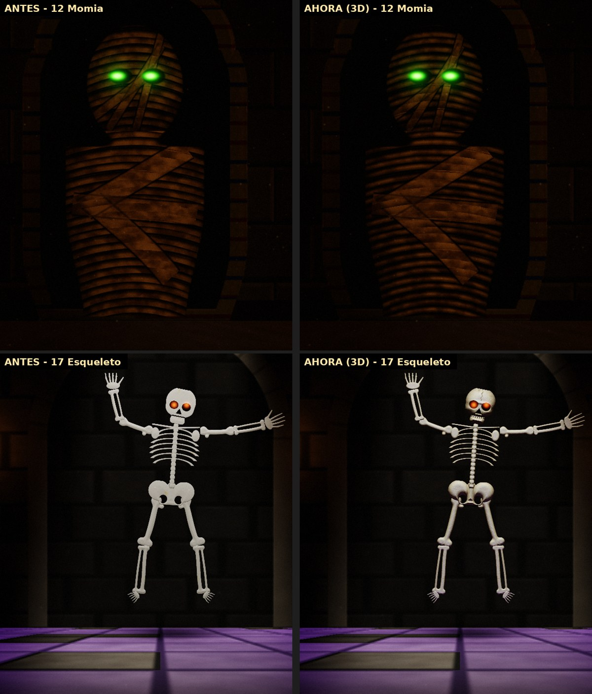

- **Esqueleto (17):** el atlas de huesos (`bake_plates_esqueleto.py`, láminas `3_huesos_color` y `4_huesos_relieve`) se hornea con volumen real: huesos largos y costillas redondeados como tubos, cráneo en domo con pómulos, arco de las cejas, cuencas y nariz hondas con borde, dientes uno por uno, sutura y vértebras; la oclusión va en el color. Antes el relieve era casi plano (la normal se escalaba x0,01). En vivo, además, **las baldosas encendidas lo iluminan desde abajo** (D6, el bajo y la ola del clímax).
- **Momia (12):** cada venda es un tubo: el canto de arriba mira hacia arriba y el de abajo hacia abajo, con los cantos más oscuros; las antorchas marcan cada vuelta.
- **Costo:** igual que antes en el banco de prueba. **Reconstruir Todo:** cambiaron las láminas de la 17.

## Fase 25: bosque de faroles y pasillo con relieve (escenas 28 y 07)

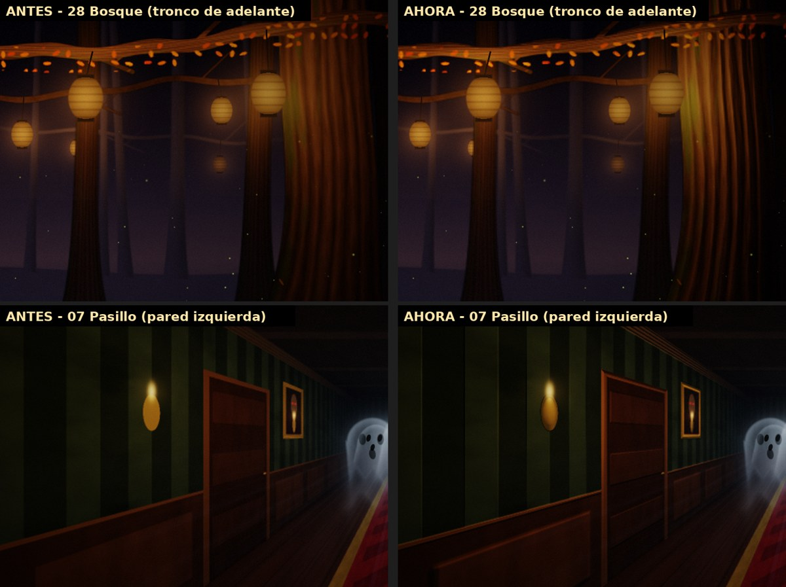

- **Bosque (28):** la capa cercana tiene relieve (`5_cerca_relieve`): troncos cilíndricos con surcos de corteza, la rama gruesa como tubo, hojas y suelo. Cada farol ilumina el tronco del lado que lo mira. El atlas de la escena bajó a 0,84 de escala para que entre la lámina nueva.
- **Pasillo (07):** relieve horneado como **normal en el mundo del pasillo** (`4_relieve` de `bake_plates_pasillo.py`): paneles del zócalo, tableros y marco de las puertas, marcos de los retratos, molduras, tablas del piso, borde de la alfombra y vigas. Las velas lo iluminan desde su posición real; el relieve solo suma o resta luz alrededor de la de siempre, así la luz rasante de la vela sobre su propia pared no se apaga.
- **Costo:** 07 sube ~20 %; 28 igual. **Reconstruir Todo:** láminas nuevas.

## Fase 26: castillo y tormenta con relieve (escenas 04 y 09)

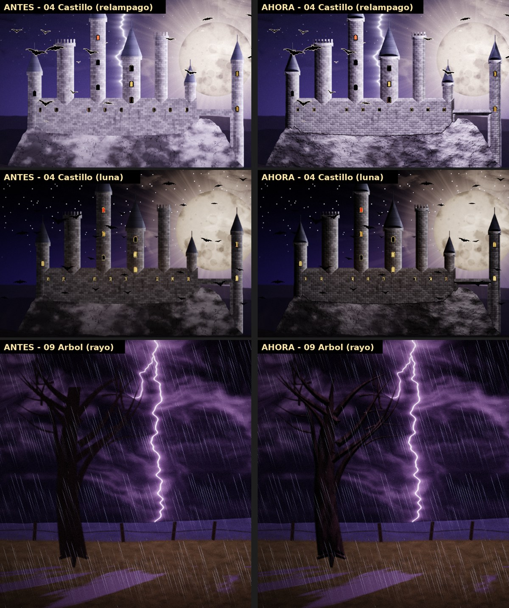

- **Castillo (04):** `3_ventanas` ahora lleva también el relieve: **RG = normal**, **B = id de ventana** (antes en R), A = 1. Así no se suma una lámina y el atlas no achica el castillo. El relieve marca torres cilíndricas con sillares, el alero de los techos, la muralla y la roca del acantilado con estratos. La luna modula la luz con la normal (modulación relativa, no se apaga nada), y el relámpago entra **por el lado donde cae** (`bx`).
- **Tormenta (09):** lámina nueva `4_arbol_relieve` (solo el recuadro del árbol, 600×500): tronco y ramas inflados como tubos con surcos de corteza (B = cavidad). El rayo ilumina el lado de las ramas que lo mira. La copa del tronco ahora termina en punta (antes se cortaba plana).
- **Costo:** igual dentro del ruido de la medición en las dos escenas. **Reconstruir Todo:** láminas y atlas nuevos.

## Fase 27: manos de zombie y túnel de calaveras con relieve (escenas 15 y 18)

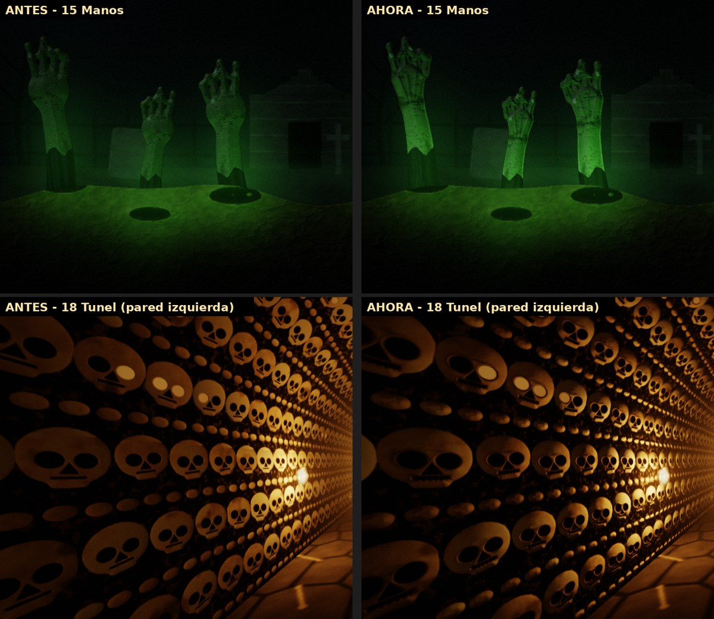

- **Manos (15):** las láminas de relieve ya existían, pero eran una sola cúpula suave. Ahora cada falange, nudillo, la palma (un trapecio plano con canto redondo, antes un círculo) y el antebrazo son tubos con volumen propio. Hay tendones en el dorso, pliegues en las articulaciones y oclusión horneada entre los dedos. En garra, las falanges dobladas quedan delante de la palma. La tumba ilumina como una luz puntual desde abajo, con un poco de luz de canto.
- **Túnel (18):** el relieve de la pared salía casi plano (la normal se escalaba por 0,004). Ahora la calavera tiene cúpula, arco de las cejas, pómulos, cuencas hondas con borde suave y dientes uno por uno, con oclusión alrededor de los agujeros. Las antorchas la recorren de costado.
- **Error corregido en el túnel:** en la pared izquierda y la bóveda, la base de la normal (T/B) estaba invertida. Con el relieve casi plano no se notaba; con el nuevo aparecía una costura entre la pared y la bóveda.
- **Costo:** igual dentro del ruido. **Reconstruir Todo:** láminas nuevas.

## Fase 28: velas y caldero con relieve (escenas 16 y 11)

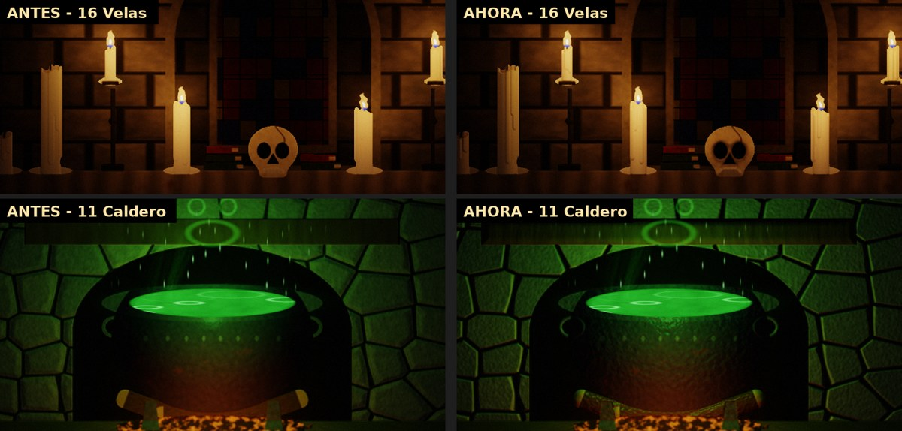

- **Velas (16):** el relieve del altar existía, pero con alturas de 3 a 10 veces menos que el tamaño real de los objetos, así que se veía plano. Ahora cada vela es un cilindro de su radio, con las chorreadas como tubos. La calavera tiene cúpula, arco de las cejas y cuencas hondas con oclusión. El candelabro y los libros tienen los cantos redondeados. Las llamas los iluminan desde donde están.
- **Caldero (11):** las piedras de la pared están abombadas y tienen oclusión en las juntas. El hierro del caldero está martillado, y las asas, la leña, la viga, los frascos y los ramos de hierbas tienen volumen. La forma esférica del caldero ya estaba.
- **Morgue (29):** las sábanas quedan como están. La lámina de marcas no tiene canal libre y el cambio pedía otra lámina por poca diferencia.
- **Costo:** igual dentro del ruido. **Reconstruir Todo:** láminas nuevas.

## Fase 29: capas encima, Miedo, navegador, guardián de FPS y límite de destellos

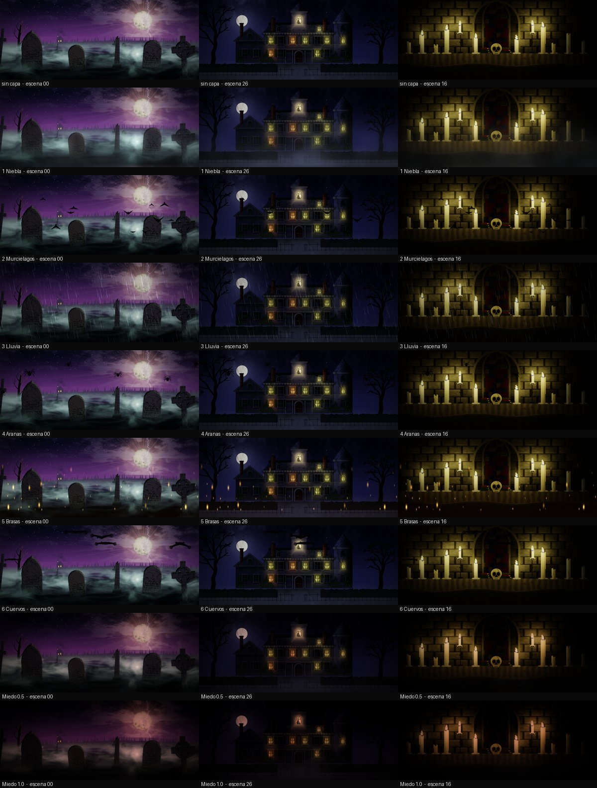

**Capas encima de las escenas** (pad 14 ON/OFF, pad 15 siguiente). Es un solo pase sobre la salida (`program_capas` en `program.py`), después del fundido y antes del bloom. Funciona en las 31 escenas, también en las de imagen y en medio de una transición. Sin capa ni Miedo, el switch `capas_pick` la saltea y no cuesta nada.

| # | Capa | Con el audio |
|---|---|---|
| 1 | Niebla baja que se arrastra; toma el color de la escena | respira con el bajo |
| 2 | Murciélagos que cruzan | con el bajo entran más |
| 3 | Lluvia en dos planos, iluminada por la escena | — |
| 4 | Arañas que bajan de su hilo y caminan por los bordes | bajan más con el bajo |
| 5 | Brasas que suben del piso | el bajo las aviva |
| 6 | Cuervos planeando | con el bombo aletea la bandada |

- **Fundido.** La capa entra y sale en 1,5 s (`capa_lag`). Si cambias de capa con una prendida, se apaga, espera el fundido y entra la nueva.
- **Escenas donde no pega** (`set.json` → `capas_excluir`): no hay lluvia ni cuervos en interiores (baño, VHS, pasillo, cripta, cabaña, tumba, velas, esqueleto, túnel, demonio, galería, espejo, las de imagen 24–25 y la morgue). Tampoco lluvia en la tormenta, murciélagos en el castillo, cuervos en la luna ni arañas en la araña. Al entrar a una de esas escenas, la capa cambia sola por la próxima que sí pega.
- **Noche.** Cuanto más avanza la noche, más niebla y más brasas.

**Miedo** (perilla 1). Va de calma a terror en todas las escenas: baja la luz y sube el contraste, la imagen tira a rojo, la viñeta se cierra y late con el bombo, aparece niebla, hay un temblor de cámara lento y la luz baja de golpe cada tanto (como mucho 2 veces por segundo). Se desliza (0,6 s), no salta. Lo que mueve solo el audio queda quieto en silencio.

**Navegador** (perilla 9). La perilla es una **posición en el setlist**: a la izquierda la primera escena, a la derecha la última. Al girarla, la escena elegida aparece en el **preview** del dashboard y en el panel (`>> NAVEGADOR 07 ...`), sin tocar lo que ve el público. El **clic** la lanza con su transición y su preset. A los 8 s sin mover la perilla, el preview deja de calcular esa escena (para no gastar FPS), pero la elección queda guardada hasta que la lances.

**Guardián de FPS** (página Guardián).
- Si el FPS **real** pasa 2 s seguidos por debajo de **40**, baja la escala de render de las escenas un escalón (0,75 → 0,6 → 0,5). Si pasa 5 s por encima de **55**, la vuelve a subir.
- El cambio se aplica durante el próximo fundido de escena, si hay uno en los 15 s siguientes; si no, se aplica igual.
- No sube nada si el failsafe ya actuó (ese se resetea a mano).
- **Arreglo de fondo:** el FPS del panel y el failsafe leían `project.cookRate`, que según la documentación de TD es la tasa **pedida** (60), no la lograda. Por eso el panel podía decir 60 con la imagen a 15, y el failsafe nunca actuaba. Ahora se mide con un Perform CHOP (`/project1/perf`, canal `fps`), con el reloj real como respaldo.
- **Ojo:** ahora el failsafe sí puede actuar. Si el FPS queda 4 s bajo 24 aun con el guardián en 0,5, apaga la estela y las dos capas, y en último caso baja la resolución de salida.

**Límite de destellos.** `td/tools/test_destellos.py` dibuja cada escena cuadro a cuadro durante su gran clímax, con bombo a 128 BPM, Chaos 0,9 y la noche avanzada. Mide también las cuatro transiciones y el Miedo, sobre una escena clara. Cuenta los destellos por segundo con el criterio WCAG 2.3.1: un cambio de luminancia de al menos 10 % con el lado oscuro bajo 80 %, en un noveno de la pantalla; el tope es **3 por segundo**. El Strobe ya tenía su tope de 3 Hz. Midiendo a 60 cuadros por segundo pasaban el tope dos cosas, ya corregidas: la **tormenta (09)**, porque el rayo suelto se sumaba al del bombo y el destello temblaba a 22 Hz, llegaba a 4 por segundo; la **transición Apagón**, porque la luz titilaba a ~22 Hz, también llegaba a 4. Ahora la tormenta da como mucho 3 y el Apagón, 1.

**MIDI, dos arreglos:**
- **Relativas.** La lectura relativa ya no se adivina. Antes, cualquier perilla absoluta cuyo primer valor caía cerca de la mitad quedaba leída como relativa: sumaba pasos en vez de tomar su posición hasta que se la llevaba a un extremo. Ahora solo se lee relativo un canal declarado en `config.RELATIVE_CHANNELS` (vacío). Además, el MIDI In CHOP solo avisa cuando el valor cambia, así que una relativa de verdad casi no llega: la solución es ponerla en Absolute en Arturia MIDI Control Center (docs/02).
- **Migración.** Se vació la "migración al layout v2" (`config.MIDI_LAYOUT_V2`). Sus canales contradecían el mapeo real del panel: con un `midi_map.json` viejo, pasaba la Energía a la perilla 7, el autopilot al pad 13 y Retro al pad 2.

**Pruebas:**
- `td/tools/test_capas_miedo.py`
- `td/tools/test_destellos.py`
- `td/tools/render_capas.py` (hoja de las capas sobre escenas reales)
- `test_perillas_relativas` y `test_layout_v2` actualizadas

**Reconstruir Todo:** hay canales, CHOPs, parámetros y un GLSL nuevos.

## Fase 30: repertorio de sucesos (motor) y la mansión como piloto

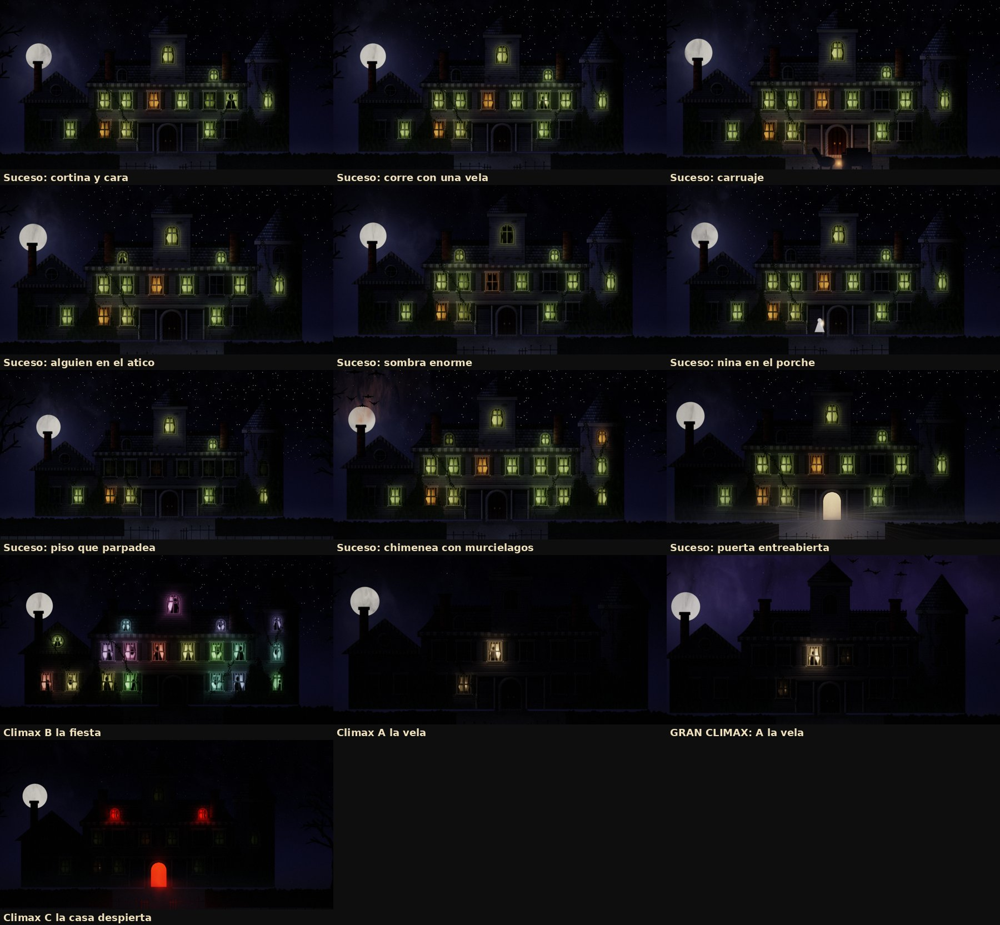

**El problema.** Cada escena tenía un solo guion de clímax, que se repetía cada 1 a 2 minutos, y uno o dos eventos chicos siempre iguales. En media hora con una escena, el mismo clímax salía entre 15 y 25 veces.

**El motor** (`common.glsl`, sirve para todas las escenas). Son cuatro niveles, más el estado de la escena:

| Nivel | Cada cuánto | Función |
|---|---|---|
| Detalle | uno cada 30 s | `hkDetalle(semilla, n, largo)` |
| Suceso | uno cada 55 s; con la Noche y el Miedo, otro entre medio | `hkSuceso(semilla, n, largo)` |
| Clímax | cerca del medio de cada casillero de 4 min (entre dos hay 2,5 a 5,5 min); rotan 3 guiones | `hkClimaxV()` + `hkClimaxVar(n)` |
| Gran clímax | uno de cada tres clímax (~12 min) o el pad Momento | `hkGrandV()` |
| Estado | cambia cada 5 min, con fundido de 25 s | `hkEstado(semilla, n)` (pesos de hasta 4 estados) |

- **Variantes sin repetición.** Salen de una permutación por vuelta, una cuenta del tipo (a·i + b) mod n con `a` coprimo con n: en cada vuelta salen todas una vez y en otro orden.
- **Borde entre vueltas.** El primero de la vuelta nueva no puede ser ninguno de los tres últimos de la anterior, porque un clímax puede comerse hasta dos casilleros.
- **Variación dentro de cada suceso.** Cada uno trae su propia semilla, que decide qué ventana, qué lado o qué chimenea.
- **Clímax.** Ningún suceso ni detalle cae encima de uno: se callan 4 s antes y vuelven 4 s después. El clímax y el gran clímax nunca salen pegados.
- **Uso en una escena:** `hkSetClimax(semilla, largo, largoGran)` al principio de `render()`.

**Mansión (26):**
- **4 estados:** noche clara, niebla espesa, tormenta lejana (un rayo cada tanto) y casa activa.
- **9 sucesos:** corre con una vela, cortina y cara, puerta entreabierta, carruaje con farol, chimenea con fuego y murciélagos, piso que parpadea, niña en el porche, sombra enorme y alguien en el ático.
- **6 detalles:** murciélago en la luna, cortina sola, ventana que se prende, ojos en el árbol, estrella fugaz y chispazo.
- **3 clímax:** **A** la vela (el de antes), **B** la fiesta (siluetas que bailan en todas las ventanas, apagón de golpe y una sola cara en el ático), **C** la casa despierta (ojos rojos en las buhardillas, la puerta como boca roja, la casa respira).
- **Gran clímax:** A, con relámpagos y murciélagos que salen de la torre.

En 30 minutos (Noche 0,3): ~37 sucesos, ~52 detalles, 7 clímax de los 3 guiones, 2 grandes clímax y 5 cambios de estado.

**Herramientas:**
- `td/tools/timeline_sucesos.py 26`: lista qué pasa minuto a minuto, leído del mismo GLSL compilado con `HK_TIMELINE`. Con `--sheet` arma una hoja con un cuadro de cada cosa.
- `td/tools/test_sucesos.py`: 3 horas en tres niveles de Noche y Miedo. Comprueba que no haya choques con un clímax, que nada se repita seguido y que salgan todas las variantes.

Los nombres de cada cosa van en las líneas `@EST/@SUC/@DET/@CLX` del encabezado del `.frag`.

**Costo y destellos:**
- **Mansión:** de ~51 a ~58–63 ms en el banco de prueba (1280×512, por software), un 10–20 % más. El gran clímax llega a ~76 ms, como antes.
- **Arreglo de costo:** la primera versión del calendario costaba hasta 3 veces más; se rehizo con una tabla de coprimos y calculando la variante solo cuando hay algo en curso.
- **Destellos:** 30 minutos seguidos de mansión dan como máximo 2 por segundo.

**Reconstruir Todo:** cambió `common.glsl` (todas las escenas lo incluyen). Las demás escenas todavía no usan el motor; siguen las fases 31–36.


## Fase 31: repertorio en las escenas 00–05

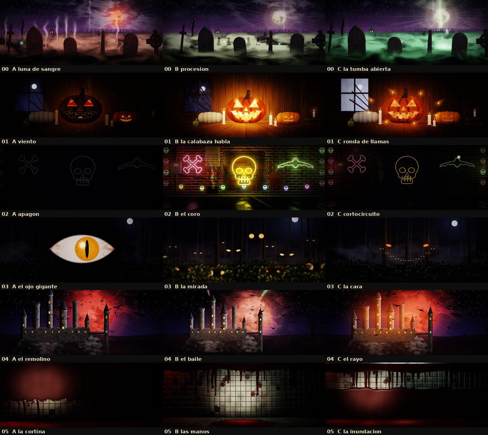

Las escenas 00 a 05 usan el motor de la fase 30. Cada una tiene 3 estados, 7 sucesos, 5 detalles y 3 clímax que rotan. Los eventos fijos de antes (`hkEvent`) pasaron a ser sucesos o estados. El clímax de siempre es ahora el guion **A**, y el gran clímax es A con su agregado de antes.

| Escena | Estados | Sucesos | Detalles | Clímax B y C |
|---|---|---|---|---|
| 00 cementerio | despejado, niebla espesa, tormenta seca, noche de almas | tumba y grieta, sepulturero con farol, mano de la tierra, perro negro, campanadas, lechuza, procesión de fuegos fatuos | estrella fugaz, murciélago en la luna, hoja que vuela, fuego fatuo rápido, vela de la capilla | **B** procesión de encapuchados con velas; **C** la tumba se abre, con un haz verde y almas en espiral |
| 01 calabaza | noche quieta, tormenta afuera, noche de viento | mira a los lados, una vela se apaga, gato en la ventana, araña que baja, la chica se ríe, bruja en la luna, risa | murciélago en la ventana, humo por los ojos, chispa, relámpago lejano, polvo en el rayo | **B** la calabaza habla; **C** ronda de llamas |
| 02 neón | llovizna, aguacero, escampa | ola de luz, chispazos, paraguas, auto que pasa, gato, cartel nuevo, cartel que cuelga | tubo que zumba, gota en el charco, relámpago lejano, vapor, rata | **B** el coro de calaveras chicas; **C** cortocircuito que recorre el cable |
| 03 ojos | luna clara, niebla, noche cerrada | todos parpadean, par rojo, código, todos miran, llora luz, bandada de ojitos, algo en los arbustos | un par se cierra, luciérnagas, hoja que cae, búho, rayo de luna | **B** la mirada (todos siguen a la cámara); **C** la cara hecha de ojos |
| 04 castillo | noche clara, tormenta, niebla en el valle | bandada enorme, murciélago gigante en la luna, la vela recorre el castillo, el vampiro en el puente, rayo en el pararrayos, sale el vampiro de la ventana roja, la niebla trepa | estrella fugaz, ventana que se apaga, murciélago cerca de la cámara, nube en la luna, chispa en el pararrayos | **B** el baile (ventanas de colores con la música, piedra iluminada, dos haces en el cielo); **C** el rayo (tres rayos en la torre, el fuego baja por las ventanas, humo y luna roja) |
| 05 sangre | luz normal, tubo moribundo, sangre que sube | salpicadura, se corta la luz, mano que se arrastra, manos que golpean, sombra en la linterna, la linterna falla, el charco borbotea | gota grande, cucaracha, el tubo se apaga, la emergencia late, burbuja en el charco | **B** las manos (huellas por toda la pared, apagón y se escurren); **C** la inundación (el charco sube por la pared con olas y baja) |

**Pruebas fuera de TD:**
- **Calendario:** `timeline_sucesos.py` y `test_sucesos.py` en 3 horas, con la Noche y el Miedo en tres niveles: sin choques con el clímax, sin repetir y con todas las variantes.
- **Destellos:** en el gran clímax, `test_destellos.py` sigue en 3 como máximo. Los rayos de la tormenta caen a lo sumo uno cada 5 s. *(Corrección de la fase 33: la medición por suceso de esta fase daba 0 por un error del script. Repetida bien, la 00 llegaba a 6 y la 02 a 7; se arreglaron en la fase 33.)*
- **Validación:** `validate_shaders` sin errores en los dos sets, y la compilación para Metal también.

**Arreglo del motor:** `hkPick` hacía muchos hashes repetidos y ordenaba un arreglo con índice variable, que en la GPU va a memoria lenta. Ahora usa dos hashes por vuelta y cuentas en escalares. El calendario es idéntico al de antes (comparado en 4 horas, en 4 escenas). El costo del "suceso extra" de la segunda mitad del casillero bajó de +20 ms a +7 ms en el banco por software.

**Costo** (1280×512 por software, promedio de 5 momentos, contra la fase 30):

| Escena | Cambio |
|---|---|
| 00 | +5 % |
| 01 | +19 % |
| 02 | +6 % |
| 03 | +14 % |
| 04 | +2 % |
| 05 | +19 % |
| 26 | −2 % (por el arreglo del motor) |

Los FPS reales hay que mirarlos en TD.

**Reconstruir Todo:** cambió `common.glsl`. Siguen la fase 32 (escenas 06–11) y las demás.

## Fase 32: repertorio en las escenas 06–11

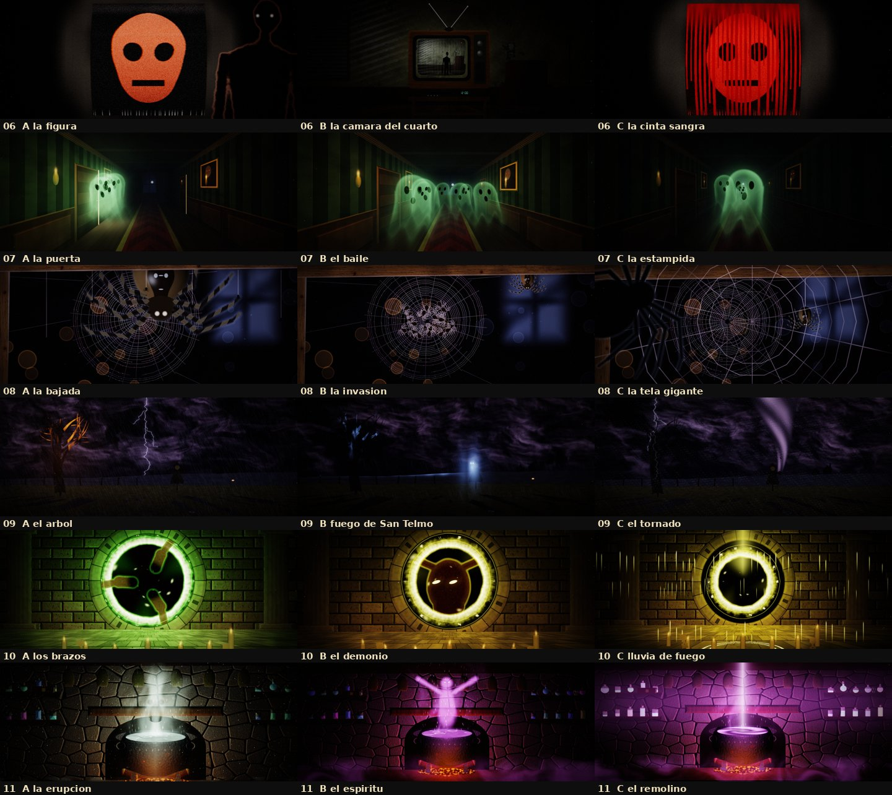

Igual que en la fase 31: 3 estados, 7 sucesos, 5 detalles y 3 clímax que rotan por escena. El clímax de antes es el **A**.

| Escena | Estados | Sucesos | Detalles | Clímax B y C |
|---|---|---|---|---|
| 06 VHS | luz de luna, cinta gastada, a oscuras | cambio de canal, figura en el sillón, pantalla azul con PLAY, cara en la estática, la tele se apaga (línea y punto), mano en el vidrio desde adentro, alguien detrás de la persiana | reloj 00:00, banda de tracking, gato, ojos en la persiana, imagen al revés | **B** la cámara del cuarto (la pantalla muestra este cuarto y alguien parado detrás de la cámara se acerca); **C** la cinta sangra (chorrea por el mueble hasta el piso) |
| 07 pasillo | velas encendidas, velas bajas, niebla espectral | pasa volando, la puerta se entreabre, ojos de los retratos, las velas se apagan de a una, la dama de blanco, atraviesa la pared, el pasillo se estira | los retratos guiñan, una vela titila, polvo en la luna, una puerta golpea, un fantasmita espía | **B** el baile (en parejas, en ronda; desaparecen de golpe con las velas); **C** la estampida (corren hacia la cámara y el último te atraviesa) |
| 08 araña | noche quieta, humedad, viento | camina al centro, ráfaga, la presa (polilla atrapada), teje una vuelta, polilla en la luz, bajan aranitas, gota que corre | destello, hilo suelto, mosquito, estira las patas, polvo en la luz | **B** la invasión (decenas de aranitas cruzan la tela); **C** la tela gigante (se teje delante de la cámara y la araña enorme la cruza) |
| 09 tormenta | tormenta, aguacero, relámpagos lejanos | el pico, ojos del espantapájaros, cuervos, rayo globular, el farol, ráfaga de hojas, relámpagos en las nubes | resplandor lejano, la ventana parpadea, cuervo en la cerca, chispas en el alambrado, gotas gruesas | **B** fuego de San Telmo (calma tensa, brillo azul en árbol, cerca y espantapájaros; un solo rayo al final); **C** el tornado |
| 10 portal | fuego, fuego brujo, humo | runas del piso, la cara en el vórtice, el brazo, bola de fuego, el portal aspira, murciélagos, temblor | una runa brilla, chispas en el anillo, un ojo en el fondo, humo que sale, una vela se apaga | **B** el demonio (cabeza con cuernos que sube y mira); **C** lluvia de fuego |
| 11 caldero | hervor tranquilo, hervor fuerte, niebla de poción | cara en el vapor, erupción, la mano, un frasco se enciende, el cucharón, ojos en la poción, el sapo | burbuja que revienta, chispa, gota del techo, los frascos tintinean, humo por la boca | **B** el espíritu (una figura de vapor abre los brazos); **C** el remolino (haz al techo y los frascos se encienden uno tras otro) |

**Detalles:**
- En la **06**, los sucesos del cuarto (figura en el sillón, persiana) sacan la cámara de la tele mientras duran, y la luz del cuarto sigue a la pantalla (azul, apagada, roja).
- En la **09**, todos los rayos sueltos siguen pasando por el sorteo por casillero de la fase 29. Los relámpagos en las nubes y el rayo final del B usan ese mismo sorteo.
- En la **10**, la cara del vórtice ahora también aparece con el golpe y Chaos alto, como decía el encabezado. Antes se calculaba pero no se dibujaba.

**Pruebas fuera de TD:**
- **Calendario:** `test_sucesos.py` da OK en las 13 escenas con repertorio.
- **Destellos:** en el gran clímax, `test_destellos.py` sigue en 3 como máximo. *(Corrección de la fase 33: la medición por suceso daba 0 por un error del script. Repetida bien, de 06 a 11 da 3 como máximo.)*
- **Validación:** `validate_shaders` sin errores en los dos sets, y la compilación para Metal también.

**Costo** (1280×512 por software, contra la fase 31):

| Escena | Cambio |
|---|---|
| 06 | +8 % |
| 07 | +15 % |
| 08 | +19 % |
| 09 | +10 % |
| 10 | +27 % |
| 11 | +11 % |

Unos 7 ms de eso son del calendario (`hkSuceso` y `hkDetalle`). Es la misma cuenta para todos los píxeles, así que en una GPU debería pesar bastante menos que en este banco. Los FPS reales hay que mirarlos en TD, sobre todo en la 10.

**Reconstruir Todo:** cambiaron los `.frag` de 06 a 11. Sigue la fase 33 (escenas 12–17).

## Fase 33: repertorio en las escenas 12–17 y límite de destellos por suceso

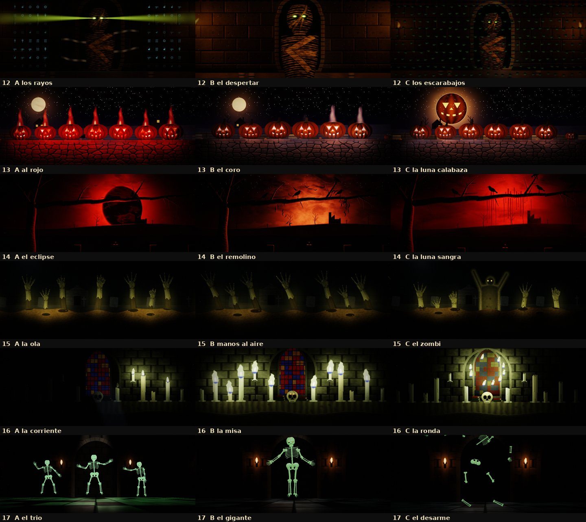

| Escena | Estados | Sucesos | Detalles | Clímax B y C |
|---|---|---|---|---|
| 12 momia | antorchas, penumbra, arena en el aire | gira la cabeza, jeroglíficos, escarabajos, venda que cae, levanta un brazo, arena del techo, humo de la vasija | chisporrotea, parpadea, jeroglífico suelto, escarabajo en la pared, polvo en la luz | **B** el despertar (da un paso hacia la cámara y se le aflojan las vendas); **C** los escarabajos (un enjambre sale del sarcófago) |
| 13 calabazas | noche clara, niebla, viento | persecución, el cuervo, se apaga y se prende, cantan en ola, murciélago en la luna, la granja se enciende, miran a un lado | estrella fugaz, chispa, parpadea, hoja que cae, nube en la luna | **B** el coro (fuego por turnos con el bajo); **C** la luna calabaza (la luna se vuelve una cara tallada y todas la miran) |
| 14 luna y cuervos | luna llena, nubes, luna de sangre | bandada, giran la cabeza, la lechuza, pelea en el aire, luz en la capilla, el caminante, hacia la cámara | estrella fugaz, sacude las alas, murciélago lejano, luz en la colina, caen hojas | **B** el remolino (cuervos en espiral alrededor de la luna); **C** la luna sangra |
| 15 manos | niebla verde, luna clara, tormenta | relámpago, saluda, el cuervo, la cripta se abre, asoma una cabeza, tamborilean, la tierra se raja | un dedo, luciérnaga, cae un terrón, nube en la luna, ojos en la cripta | **B** manos al aire (todas se mecen juntas con el bajo); **C** el zombi (sube un cuerpo entero por el agujero del centro) |
| 16 velas | velas calmas, corriente, humo | la luna, apagón, la calavera, llora cera, sombra en el vitral, llamas verdes, la llama flota | se aviva, chisporrotea, humo de una apagada, polilla, gota de cera | **B** la misa (llamas altas que laten juntas, vitral de colores, la calavera mira); **C** la ronda (las llamas vuelan en círculo frente al vitral) |
| 17 esqueleto | foco, luz negra, antorchas | el solo, pierde la cabeza, se desarma, brazos arriba, foco rojo, moonwalk, lluvia de huesos | guiña, saltito, brillo en el cráneo, cae polvo, chisporrotea | **B** el gigante (crece y baila lento); **C** el desarme (los huesos vuelan girando y se rearman) |

**Destellos por suceso (corrección):**
- **El error:** la medición por suceso de las fases 31 y 32 se hacía con un script mío que compilaba la escena antes de calcular la línea de tiempo. Esa cuenta deja el estado de OpenGL cambiado, los cuadros salían mal y todo daba 0. Repetida bien, casi todas las escenas dan 3 por segundo en el peor caso de la prueba (golpe a 128 BPM con Chaos 0,9), que es el golpe mismo.
- **Las que se pasaban:**
  - **00 cementerio:** llegaba a 4–6, y eso ya pasaba antes del repertorio. El destello del golpe y el latido de la niebla, sumados, se pasaban. El destello del golpe ahora va al 45 %, el latido de la niebla es más suave y se calla durante el relámpago del estado tormenta.
  - **02 neón:** los chispazos llegaban a 7. El temblor del cartel y la caja eléctrica pasan a un ritmo lento.
- **Ahora:** `test_destellos.py --sucesos` mide cada suceso, detalle y clímax de las escenas con repertorio (la primera vez que sale cada uno en una hora, con Noche 0,8 y Miedo 0,5). Da 3 como máximo en todo el set.

**Pruebas fuera de TD:**
- **Calendario:** `test_sucesos.py` da OK en las 19 escenas con repertorio.
- **Validación:** `validate_shaders` sin errores en los dos sets, y la compilación para Metal también.

**Costo** (1280×512 por software, contra la fase 32):

| Escena | Cambio |
|---|---|
| 00 | −3 % |
| 02 | −2 % |
| 12 | +11 % |
| 13 | +6 % |
| 14 | +12 % |
| 15 | +10 % |
| 16 | +19 % |
| 17 | +25 % |

Los FPS reales hay que mirarlos en TD, sobre todo en la 16 y la 17.

**Reconstruir Todo:** cambiaron los `.frag` de 00, 02 y 12 a 17. Sigue la fase 34 (escenas 18–25).

## Fase 34: repertorio en las escenas 18–25 (versión liviana)

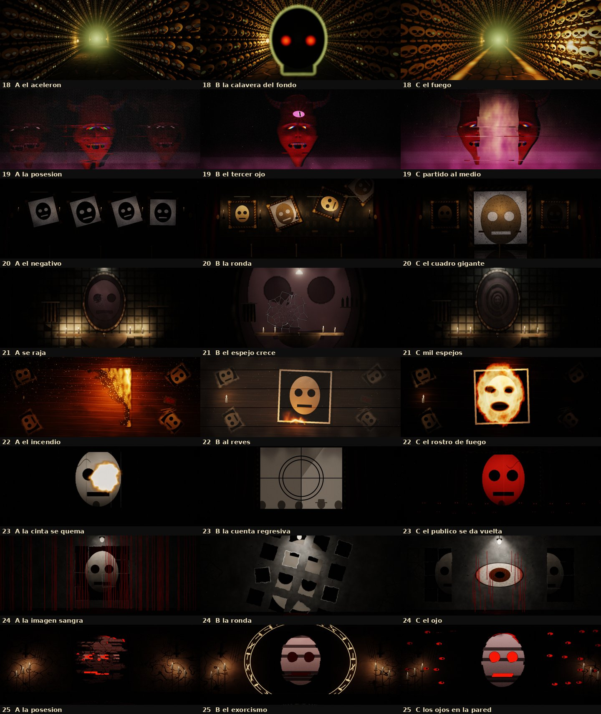

Mismo motor que en las fases 30–33, con menos piezas por escena para cuidar los FPS: 3 estados, 5 sucesos, 4 detalles y 3 guiones de clímax (A es el clímax que ya tenía la escena).

| Escena | Estados | Sucesos | Detalles | Clímax B y C |
|---|---|---|---|---|
| 18 túnel de calaveras | antorchas, oscuridad verde, niebla espesa | ola de ojos, figura al fondo, se apagan las antorchas, cae una calavera, retrocede | guiña, polvo, chisporrotea, ratas | **B** la calavera del fondo (silueta negra con ojos rojos); **C** el fuego (llamas por los costados del piso) |
| 19 demonio glitch | señal estable, interferencia, fuego alto | se derrite, llora fuego, sin señal (barras de color), se acerca, mosaico | parpadea, chispas, línea de tracking, espejo | **B** el tercer ojo; **C** partido al medio |
| 20 galería | lámparas, velas, penumbra | apagón, se suelta un cuadro, los ojos se corren, una sombra, sangra | una vela, lámpara titila, polvo, araña | **B** la ronda (los cuadros giran); **C** el cuadro gigante (el del medio crece y tapa el resto) |
| 21 espejo | bombita, velas, vapor | limpia el vapor, apagón, una cara en el vapor, alguien detrás, gotea sangre | la bombita se balancea, una gota, una vela, huella de mano | **B** el espejo crece; **C** mil espejos (espejo dentro de espejo) |
| 22 se quema | vela, viento, a oscuras | ráfaga, rostro en el humo, se da vuelta, llamarada, sangra | chispa, un fósforo, aro de humo, ceniza | **B** al revés (el fuego retrocede y la foto se rearma); **C** el rostro de fuego |
| 23 película 1920 | plata, sepia, proyector gastado | el iris, cartel, se da vuelta, al revés, una sombra | un pelo, quemadura, parpadeo, polvo grueso | **B** la cuenta regresiva (cola de película con el círculo que barre); **C** el público se da vuelta (pantalla roja y ojos en la sala) |
| 24 sangra | lámpara, penumbra, la sangre sube | la pared llora, se apaga la lámpara, la mano ensangrentada, se despegan algunos pedazos, crece el charco | una gota, salpicadura, polilla, revoque | **B** la ronda (la imagen da una vuelta entera abriéndose en pedazos); **C** el ojo (la imagen se abre como una puerta y detrás hay un ojo enorme que mira) |
| 25 posesión | velas, las venas, frío | se encienden los ojos, se avivan las velas, se da vuelta, arañazos nuevos, las tiras se desordenan | una vela se apaga, gota negra, la cruz gira, una sombra | **B** el exorcismo (un círculo de runas alrededor de la imagen se enciende runa por runa y una luz blanca la limpia); **C** los ojos en la pared (ojos rojos por toda la pared que miran la imagen) |

**Notas:**
- **24:** la imagen entra y sale cada 32 s. Si el clímax B o C, o el suceso "se despegan", cae en el hueco, los pedazos llegan antes y se quedan hasta el final. La ronda y la puerta mueven la grilla entera porque la escena busca cada pedazo solo entre las celdas vecinas.
- **Destellos:** se bajaron parpadeos rápidos que ya estaban:
  - **19:** la inversión sortea 2 veces por segundo (antes 14).
  - **20:** el negativo del clímax A sortea 3 veces por segundo (antes 9).
  - **24:** la lámpara del clímax A sortea 4 veces por segundo (antes 13), o sea que se apaga a lo sumo 2 veces.
  - **25:** la inversión de la posesión se prende 1,5 veces por segundo (antes 6).
- **Semillas:** la semilla de las quemaduras y las rajaduras (21 y 23) se renueva cada 4 minutos y no en cada clímax.

**Pruebas fuera de TD:**
- **Calendario:** `test_sucesos.py` da OK en las 27 escenas con repertorio. `timeline_sucesos.py` muestra que cada suceso sale unas 36–48 veces en 3 horas y cada clímax 9–11 veces.
- **Destellos:** `test_destellos.py --sucesos --scenes 18,...,25` da 3 como máximo.
- **Validación:** `validate_shaders` sin errores en los dos sets, y la compilación para Metal también. Las demás pruebas de `td/tools` dan OK.

**Costo** (1280×512 por software, contra la fase 33):

| Escena | Cambio |
|---|---|
| 18 | +10 % |
| 19 | 0 % |
| 20 | +9 % |
| 21 | −6 % |
| 22 | +12 % |
| 23 | +14 % |
| 24 | +9 % |
| 25 | +19 % |

Los FPS reales hay que mirarlos en TD, sobre todo en la 20, la 24 y la 25 (las de imagen son las más caras).

**Reconstruir Todo:** cambiaron los `.frag` de 18 a 25. Sigue la fase 35 (Resplandor); las escenas 27–30 pasan a la 36 y el control en vivo a la 37.

## Fase 35: Resplandor (cuánto brilla lo claro)

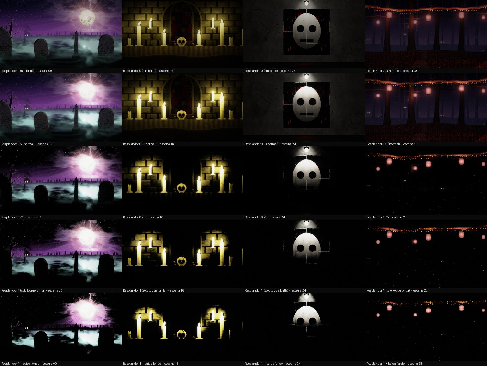

Pedido del VJ: a mano en TD usaba **Bloom + Level** que suben con el bajo, para que solo brillen los detalles más claros y el resto desaparezca. Ahora es un control del bloom del programa (`program.py`, canal `glow`, parámetro **Resplandor** en la página Capas). En Halloween lo mueve la **tira de Mod** del MiniLab (`set.json` → `midi_redirect`). La tira deja de recorrer la carpeta de imágenes; para cambiar de imagen queda el pad 6.

| Tira | Qué pasa |
|---|---|
| Abajo (0) | Nada brilla: se apaga el bloom y queda la escena tal cual |
| Centro (0,5, al arrancar) | El bloom de siempre |
| Arriba (1) | **Solo lo que brilla**: sube el umbral del glow (entra solo lo más claro), lo oscuro de la imagen se hunde a negro (nivel de negro, sin cambiar el tono), el glow crece y sube el grano de película |

- **El bajo:** arriba del centro, el bajo empuja las tres cosas a la vez: el umbral, el nivel de negro y el glow. En cada bajo queda aún menos imagen y lo claro brilla más. Usa el bajo (que es suave) y no el golpe, así late con la música sin cortar a negro de golpe ni sumar destellos. Con la perilla Audio en 0 no late.
- **El grano:** con lo oscuro hundido, el grano es lo que mantiene la textura del cuadro. Es más fuerte en los medios tonos.
- **La otra tira:** si se prefiere que vuelva solo al centro al soltarla, se puede aprender la tira de Pitch en el mismo parámetro (vuelve sola a 0,5 = normal).

**Arreglo del bloom (afecta a los dos sets):** el bloom y el contorno del texto calculaban el tamaño de un pixel con `uTD2DInfos[i].res.zw`. En TD, `res` es (1/ancho, 1/alto, ancho, alto), así que `.zw` es el tamaño en pixeles y no el de un pixel. Las muestras caían lejísimos y el glow armaba copias fantasma corridas de la imagen en lugar de un halo. Ahora usa `.xy`. En el centro de la tira el bloom se ve distinto que antes: halos limpios alrededor de lo claro y sin fantasmas.

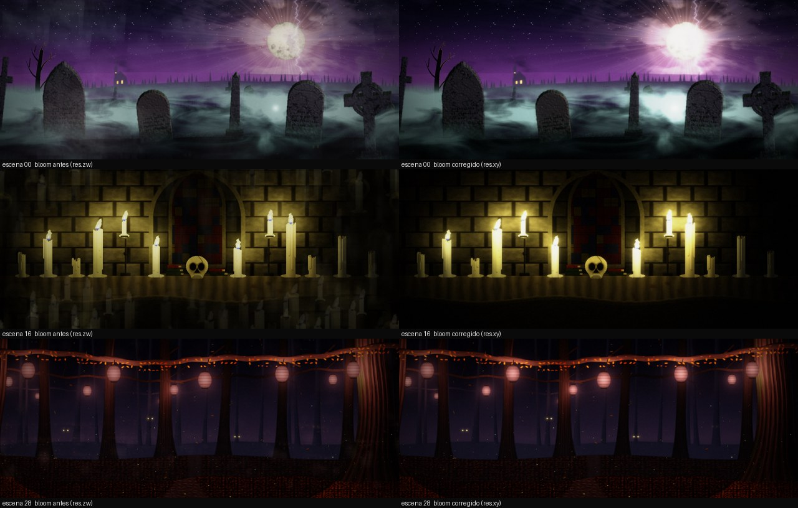

**Pruebas fuera de TD:**
- **Control:** `test_resplandor.py` da OK. Revisa el canal y el parámetro (0,5 por defecto), que la tira escriba Resplandor sin mover la carpeta y el GLSL: 0 = escena sin glow, 0,5 suma glow, 1 hunde lo oscuro y el bajo hunde aún más.
- **Hoja:** `render_resplandor.py salida.png --set halloween`.
- **Resto:** `validate_shaders` sin errores en los dos sets y todas las demás pruebas en OK.

**Costo:** de 0 a 0,5 es el mismo que antes. Arriba de 0,5 suma una cuenta de nivel y una de grano por pixel, muy poco al lado del bloom. Confirmar en TD.

**Reconstruir Todo:** canal nuevo en la textura de control (`glow`), parámetro nuevo y shaders del bloom cambiados.

## Fase 36: el show sigue a la música (frases, break y drop)

Hasta ahora el calendario de sucesos y clímax era solo reloj: un suceso cada ~55 s y un clímax cada ~4 min, en momentos al azar. Ahora sigue el pulso del bombo:

| Qué | Cómo |
|---|---|
| **Sucesos y detalles** | Arrancan en el "1": de una frase de 8 compases, o de 4, 2 o 1 compás, el más largo que entre en el lugar que tiene cada uno (a 128 BPM suele ser cada 4 compases) |
| **Break** (la música sigue, sin bombo) | Los sucesos y detalles se apagan en 1,5 s: la escena respira |
| **Drop** (vuelve el bombo después de un break de 4 s o más) | Si toca clímax, el aviso crece durante el break y el **pico cae justo en el drop**. La frase arranca de nuevo en ese golpe |
| **Sin drops** | Si pasan 5,5 min sin clímax, cae igual: el pico en el "1" de una frase |
| **Espaciado** | Nunca dos clímax a menos de 2,5 min (el Momento a mano también cuenta, y cancela el que estaba por venir). Uno de cada tres sigue siendo el gran clímax |
| **Sin pulso** (sin bombo, sin audio o el control apagado) | Vuelve solo al calendario de reloj de siempre |

- **Dónde está:** la lógica es Python puro en `td/vjcore/ritmo.py`. Recibe cada golpe por `media_logic` (canal `beat`) y un aviso cada ~0,2 s desde `diagnostics`.
- **Cómo mide el tempo:** con una recta sobre los últimos 48 golpes (tiempo contra número de golpe), así el jitter de cada golpe se promedia. Ignora contratiempos y golpes perdidos y vuelve a enganchar si cambia el tempo.
- **Qué recibe el shader:** los canales `mbeat`, `manchor`, `mbrk0/1` y `mclx*`. Las funciones de `common.glsl` (`hkSuceso`, `hkDetalle`, `hkClimaxV`, `hkGrandV`, `hkClimaxVar`) los usan, así que las 27 escenas con repertorio lo toman sin cambiar su `.frag`. Con todos en 0, el calendario es idéntico al anterior: lo comparé en las escenas 26, 00 y 22.
- **La grilla es estable:** se publica de nuevo solo si el pulso real se corrió más de 40 ms o el tempo cambió más del 1 %. Si se publicara en cada golpe, un suceso que cae cerca de un "1" saltaría al siguiente y titilaría.
- **Control:** página Capas, **Seguir la música** (`Ritmoon`, prendido) y **BPM detectado**. El dashboard muestra `RITMO 128 BPM`, `BREAK -> climax en el drop` o `buscando el pulso`.

**Límites:**
- **El "1":** sin un drop no hay forma de saber dónde está el "1" real del tema. Hasta el primer drop, la frase arranca donde se enganchó el pulso.
- **Drops sin break:** un drop sin un break de al menos 4 s sin bombo no se detecta como drop. En esos temas el clímax cae por frase.
- **Escenas 27–30:** usan la versión vieja del clímax, que sigue por reloj. Pasan al motor nuevo cuando tengan su repertorio.
- **Movimiento a tempo:** que los ciclos de cámara y luz completen 1, 2 o 4 compases queda para otra fase.

**Pruebas fuera de TD:** `test_ritmo.py` da OK. Usa música sintética con ±12 ms de jitter, 5 % de golpes perdidos y contratiempos sueltos:
- **Pulso:** engancha en ~5 s y mide 128,0 BPM.
- **Frases:** caen cada 32 tiempos, sobre un tiempo real.
- **Break y drop:** el break y el drop se detectan, y el pico del clímax cae en el drop.
- **Clímax:** nunca hay dos a menos de 150 s, y sin drops el pico cae en el "1" de una frase.
- **Tempo y huecos:** un hueco corto no corre las frases, y un cambio de 128 a 100 BPM se re-engancha en menos de 5 s.
- **Sin bombo:** vuelve al reloj.
- **control_script:** publica los parámetros y apagado los deja en 0.
- **Shader real:** en las escenas 26, 00 y 18, con 9 minutos de tema, cada suceso y detalle arranca en un "1", hay respiro en el break, el pico cae en el drop y ningún suceso cae encima de un clímax.
- **Resto:** `validate_shaders` sin errores en los dos sets, la compilación para Metal también, y las demás pruebas en OK.

**Hay que probarlo en TD con música real.** La detección depende de que el bombo dispare bien `beat` (el umbral es `Kickthreshold`, página Audio). Si el BPM del dashboard salta o queda en "buscando el pulso" con un tema de bombo claro, hay que ajustar ese umbral.

**Reconstruir Todo:** canales nuevos en la textura de control (`mbeat` … `mclxarm`), parámetros nuevos y cambios en `media_logic`, `diagnostics` y `control_script`.

## Fase 37: todas las escenas responden a las teclas

Al tocar se notaba poco en varias escenas. Para medirlo, `td/tools/medir_teclas.py` renderiza cada escena en el mismo instante sin teclas y con un acorde de 3 teclas sostenidas (grave, medio y agudo), y mide cuánta imagen cambia. Usa el peor de tres instantes.

- **Antes:** 17 de las 31 escenas cambiaban menos del 1–3 % de la pantalla: 00, 03, 04, 05, 08, 11, 12, 14, 15, 17, 21, 23, 24, 26, 28, 29 y 30. Todas tenían su reacción programada (el alma, la bandadita, la burbuja, el chorro), pero el objeto era tan chico que desde lejos no se leía.
- **Ahora:** cada tecla además **ilumina la escena en su posición**, con la luz propia de esa escena. Es `hkKeyLit` en `common.glsl`: multiplica lo que ya hay (los negros siguen negros), con un color en el grave y otro en el agudo, y la forma que pide cada escena. La fuerza agranda y aviva la luz.

| Escena | Luz de la tecla |
|---|---|
| 00 cementerio | el alma ilumina las lápidas (verde a celeste) |
| 03 ojos | rojo a ámbar alrededor de los ojos |
| 04 murciélagos | violeta a luna cálida contra el cielo |
| 05 y 24 sangre | columna roja donde cae la sangre |
| 08 araña | la tela se ilumina donde baja la araña |
| 11 caldero | la poción ilumina la pared (verde a violeta) |
| 12 momia | una antorcha se aviva |
| 14 cuervos | el cielo arde detrás del cuervo |
| 15 manos | la tierra brilla verde donde sale la mano |
| 17 esqueleto | un foco por tecla (blanco a luz negra) |
| 21 espejo, 23 película | luz fría o del proyector en esa zona |
| 26 mansión | se enciende la zona de una ventana |
| 28 faroles | el farol se aviva |
| 29 morgue | el tubo de esa zona se prende |
| 30 carnaval | luces de feria (rosa a celeste) |

**Resultado:** las 17 pasan a cambiar entre el 14 y el 45 % de la imagen con el acorde. Ninguna queda floja. Hoja: `docs/img/teclas_luz.jpg` (sin teclas, con acorde y la diferencia).

**Pruebas:**
- **Medición:** `test_teclas.py` corre `medir_teclas.py --check` sobre las 31 escenas y falla si alguna vuelve a quedar floja. Tarda ~1 min.
- **Destellos:** sin teclas las escenas no cambian, así que la medición de destellos sigue igual.
- **Resto:** `validate_shaders` sin errores en los dos sets, la compilación para Metal también, y las demás pruebas en OK.

**Costo:** sin teclas, nada (la voz que no suena corta enseguida). Con teclas, un óvalo por voz.

**En TD:** probar con el piano real que la luz se lea bien en cada escena y que no tape lo que hace cada una. Si alguna queda muy fuerte, se baja en la línea `hkKeyLit` de esa escena.

**Reconstruir Todo:** cambiaron `common.glsl` y 17 `.frag`. Con **Recargar Shaders** también alcanza.

## Fase 38: easter egg "JAY INFINITO" en cada escena

Cada escena esconde una firma del VJ (JAY, el símbolo infinito, J. Infinito, según la escena), hecha con el material de la propia escena: grabada en piedra, escrita con humo, dibujada por una bandada. Es un easter egg, no un logo.

- **Cuándo sale:** uno cada ~12 minutos por escena y dura 5 s. Nunca cae encima de un clímax y, si hay pulso, arranca en el "1" (fase 36).
- **A mano:** el **pad 9** (en Halloween; hay que aprenderlo una vez con Learn) o **Capas > Lanzar easter egg** lo muestra ya en la escena que está al aire. Mientras dura, otra pulsada no lo reinicia.
- **Motor** (`common.glsl`):
  - `hkEgg(seed)` da la envolvente y el avance.
  - `hkText` es una tipografía de trazos con mayúsculas, unos números, signos y el ∞ (código 8).
  - `hkInfD` da la distancia al ∞ y `hkInfPath` un recorrido en ∞.
- **Canal y control:** el canal `secret` y el parámetro `Secreton`, como el Momento.
- **Herramienta:** `td/tools/render_jay.py` muestra cada escena sin y con el easter egg, más un recorte agrandado. Con `--check` mide que se vea y que no pase de 3 destellos por segundo.
- **Prueba:** `test_jay.py` revisa el canal, el pad, el disparo y todas las escenas que ya tienen easter egg.
- **Ramas:** cada escena va en su propia rama (`claude/halloween-f38-jay-NN-...`), anidadas en orden. La primera trae además el motor.

| Escena | Easter egg |
|---|---|
| 00 cementerio | En la lápida grande de la izquierda aparece grabado **JAY** y un **∞** debajo; el surco brilla verde, más con el relámpago |
| 01 calabaza | La boca tallada pasa a ser un **∞** por el que sale la luz de adentro |
| 02 neón | Un cartel de neón viejo se prende con zumbido y se lee **JA_**; la **Y** llega tarde y se queda |
| 03 ojos | Un par de ojos se abre en el medio de la oscuridad y el brillo de sus miradas traza un **∞** alrededor; parpadean una vez |
| 04 murciélagos | Una fila de 30 murciélagos vuela frente a la luna dibujando un **∞**; la bandada normal deja libre la luna mientras tanto |
| 05 sangre | Alguien escribe **JAY** con sangre en la pared, de izquierda a derecha, y después las letras chorrean |
| 06 VHS | La tele muestra un cartel de videocasetera (letras blancas con sombra) **JAY ∞** y el reloj de la videocasetera dice **JAY∞** en vez de 12:00 |
| 07 fantasmas | Un fantasmita da una vuelta en **∞** por el pasillo dejando una estela de luz, y se desvanece |
| 08 araña | En el centro de la tela se teje un **∞** de hilo, primero un lazo y después el otro, con gotitas de rocío |
| 09 tormenta | Entre las nubes queda un rayo quieto con forma de **J** que crepita sin destellar |
| 10 portal | El anillo de fuego del portal se estira en un **∞**, dos aros de fuego unidos, y vuelve |
| 11 caldero | El vapor se enrosca en un **∞** sobre el caldero y después se deshace hacia arriba |
| 12 momia | Una venda se desenrolla del hombro de la momia y queda colgando en el aire con forma de **J** |
| 13 calabazas en hilera | Las tres calabazas del medio se encienden de a una y en vez de caras tienen tallado **J · A · Y** |
| 14 luna y cuervos | Tres cuervos se posan de a uno en la rama y sus siluetas son las letras **J · A · Y**, con cabeza, pico y un ojo que brilla con la luna; los otros cuervos dejan libre ese tramo |
| 15 manos zombie | Una chispa verde de la tumba dibuja en el aire un **∞** justo sobre las manos y queda brillando hasta apagarse |
| 16 velas | El humo de las dos velas del medio sube ondulando y arriba se cruza en un **∞** |
| 17 esqueleto | El esqueleto del centro mueve la cadera dibujando un **∞** y deja una estela de luz |
| 18 túnel de calaveras | Las calaveras de la pared izquierda que caen dentro de **JAY** se encienden en rojo, y en la derecha las de un **∞** |
| 19 glitch demoníaco | Aparece un cartel de canal de los de antes, con colores corridos: **CANAL ∞ - JAY** |
| 20 galería | Bajo un cuadro aparece una placa de bronce con letras grabadas: **J.INFINITO 1666** |
| 21 espejo | El espejo se empaña y alguien escribe con el dedo un **∞** y debajo **JAY**; el borde de cada trazo queda mojado y brilla |
| 22 se quema | Una brasa recorre la foto y deja quemado un **∞** con el borde encendido; al final se apaga |
| 23 película 1920 | Aparece un intertítulo de cine mudo: **JAY INFINITO / PRESENTA** con un **∞** de adorno |
